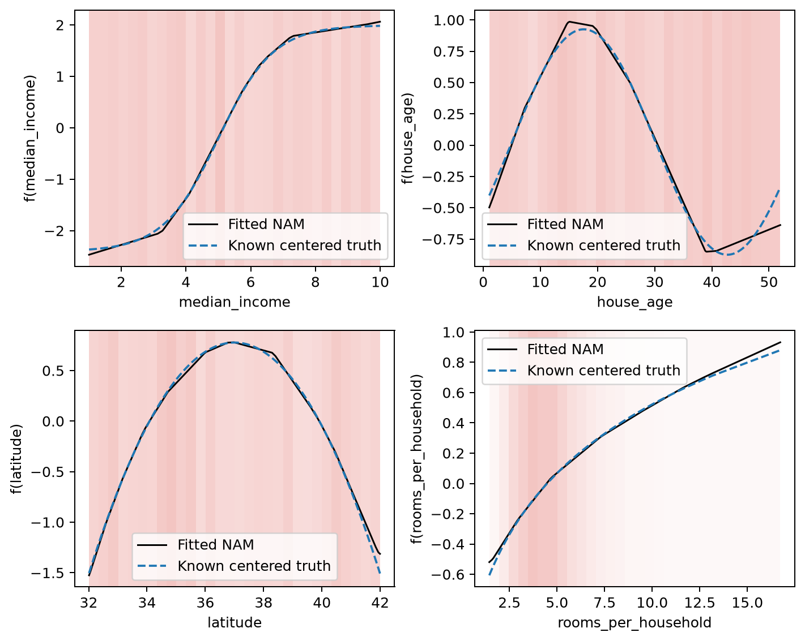
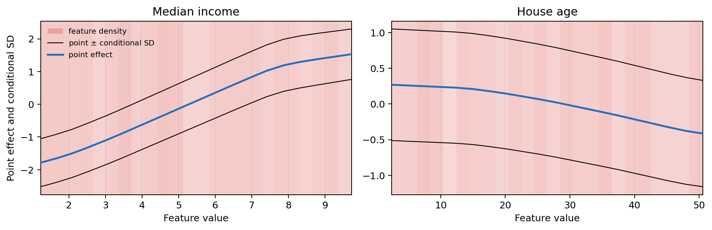

# NAMpy — Statistical and Neural Additive Models in Python

For the public API, start with estimators in `nampy.models`, probability queries in
`nampy.distributions`, analysis (including Fisher information, effects and
importance) in `nampy.diagnostics`, and rendering in `nampy.plotting`. See
[API and family selection](docs/user_guide/api_and_families.rst) for the generated
backend support table and prediction semantics.


NAMpy brings serious statistical additive modeling and a broad collection of
neural additive models into one Python workflow. Fit nonlinear relationships,
inspect individual effects, impose shape constraints, and model changing
distributions for regression and classification tasks. Its Python-native GAM
engine covers formulas, smooth construction, penalized fitting, automatic
smoothness selection, inference, and diagnostics without requiring R, while
architectures such as NAM, NBM, IGANN, GPNAM, SIAN, SPAM, and NodeGAM retain
their neural training semantics. Public estimators follow scikit-learn's
`BaseEstimator` interface and use `Regressor`, `Classifier`, or `LSS` suffixes
for their supported objectives.

## Installation

NAMpy supports Python 3.11 and 3.12. Install it with:

```bash
pip install nampy
```

Split conformal prediction intervals are available across the statistical and
neural backends through `nampy.calibration`. Use a separate calibration cohort;
see [prediction calibration](docs/user_guide/calibration.rst) for absolute-residual
and quantile methods, fitted snapshots, and explicit coverage assumptions.

Piecewise survival models accept complete start/stop covariate histories through
`LongitudinalSurvivalTarget`, with explicit future-path prediction shared across
both backends. `CoxGAM` adds static fixed/eligible automatic-smoothing partial likelihood; its
unsupported smoothing and inference routes are documented in the
[survival guide](docs/user_guide/survival.rst).

## Interpreting predictions

An additive model represents its predictor as a baseline plus contributions from its terms:

$$
\eta(x)=\beta_0+\sum_{t\in\mathcal T}f_t(x_{S_t})+o(x),
\qquad
\mu(x)=g^{-1}\{\eta(x)\}.
$$

A term may describe one feature or an interaction. Some architectures also include a global component, whose dependence should be interpreted separately.

Distributional models use one predictor for each distribution parameter:

$$
\eta_k(x)=\beta_{0k}+\sum_{t\in\mathcal T_k}f_{tk}(x_{S_t})+o_k(x),
\qquad
\boldsymbol{\theta}(x)=T\{\boldsymbol{\eta}(x)\}.
$$

Here, $T$ applies the family’s parameter transformations. Contributions add before these transformations.

Use `predict_components()` to inspect the decomposition and the plotting methods to examine fitted effects. See the [interpretability guide](https://nampy.readthedocs.io/en/latest/user_guide/interpretability.html) for centering, interactions, and uncertainty.

## Quick start — Fitting a model

NAMpy’s public estimator classes follow the scikit-learn estimator interface and implement familiar methods such as fit(), predict(), score() and supporting scikit-learn workflows like cross-validation and hyperparameter search.

#### Generalized Additive Model (GAM)

The sklearn-style adapters default to automatic REML smoothness selection.

```python
import numpy as np
import pandas as pd

from nampy.models import GAMRegressor

rng = np.random.default_rng(7)
x = np.linspace(0.0, 1.0, 300)
data = pd.DataFrame(
    {
        "x": x,
        "group": rng.choice(["a", "b"], size=x.size),
        "y": np.sin(2 * np.pi * x) + rng.normal(scale=0.15, size=x.size),
    }
)

model = GAMRegressor(
    formula="y ~ s(x, bs='cr', k=12) + group",
    smoothing_method="reml",
).fit(data)

prediction = model.predict(data)
summary = model.summary()
components = model.predict_components(data)
```

Without a formula, the adapter creates one smooth main effect per input
column:

```python
X_train = data[["x"]].iloc[::2]
y_train = data["y"].iloc[::2]
X_test = data[["x"]].iloc[1::2]
y_test = data["y"].iloc[1::2]

model = GAMRegressor(k=10, basis="tp").fit(X_train, y_train)
prediction = model.predict(X_test)
standard_error = model.standard_errors(X_test)
```

Use the dedicated `GAMLSS` estimator when multiple additive predictors jointly
describe one response distribution:

```python
from nampy.models import GAMLSS

rng_dist = np.random.default_rng(11)
data_dist = data.copy()
noise_scale = 0.08 + 0.30 * np.sin(2 * np.pi * data_dist["x"]) ** 2
data_dist["y"] = (
    np.sin(2 * np.pi * data_dist["x"])
    + 0.25 * (data_dist["group"] == "b")
    + rng_dist.normal(scale=noise_scale)
)

model = GAMLSS(
    family="normal",
    formula={
        "mu": "y ~ s(x, bs='cr', k=10) + group",
        "sigma": "~ s(x, bs='cr', k=8)",
    },
).fit(data_dist)

parameters = model.predict_parameters(data_dist)       # columns: mu, sigma
point_prediction = model.predict_point(data_dist)
raw_predictors = model.predict_link(data_dist)
```

`GAMRegressor` accepts single-predictor regression families,
`GAMClassifier` accepts binary binomial families, and `GAMLSS` accepts
multi-parameter GAMLSS families.

The low-level `nampy.gam.GAM` interface provides direct access to supported
response families and retains mgcv-style prediction conventions.

NAMpy's GAM implementation covers the statistical model lifecycle from formula
parsing and smooth construction through fitting, prediction, inference, and
diagnostics. Ordinary and shape-constrained terms share the same formula,
result, and prediction interfaces.

### GAM functionality


| Formula surface    | Supported terms                                                                                       |
| ------------------ | ----------------------------------------------------------------------------------------------------- |
| Metric smooths     | `s(..., bs='bs')`, `cr`, `cs`, `cc`, `cp`, `ds`, `gp`, `ps`, `sos`, `tp`, `ts`                        |
| Structured smooths | Markov random fields `mrf`, random effects `re`, factor smooths `fs`, sum-to-zero factor smooths `sz` |
| Bounded spatial surfaces | Soap films `so`, boundary films `sf`, and zero-boundary interior components `sw`, with supplied boundary loops and interior knots |
| Tensor products    | `te(...)`, `ti(...)`, and `t2(...)` with constructor-specific supported marginals (see the [smooth-basis reference](https://nampy.readthedocs.io/en/latest/api/gam_smooths.html))                                        |
| Linear functionals | Matrix-valued locations with weighted or unit-weight summation across supported numeric, categorical, adaptive and soap bases; see the smooth-basis reference for composition limits |
| Parametric terms   | numeric and factor terms, fitted `factor`/`ordered`/`interaction`/`cut`/`poly` transformations, supported interactions, intercept policies, and formula offsets             |
| Shared smoothing   | supported `id=` groups, fixed/free smoothing parameters, `select=True`, and `pc=` on supported bases  |


For spherical splines, write
`s(latitude, longitude, bs='sos')`: coordinates are degrees in latitude-first,
longitude-second order. A spherical marginal inside `te()` or `ti()` needs
`d=2`. Because the array API creates one smooth per input column, joint SOS
terms use the formula interface.

The [matrix-functional example](examples/example_matrix_functionals.py) fits
weighted surfaces and tensors with prediction uncertainty. Matrix cells can
also hold categorical labels for random effects and MRFs; supported `fs`
compositions use a scalar group factor. See the
[smooth-basis reference](docs/api/gam_smooths.rst) for accepted combinations
and the explicit matrix `cs` and matrix `t2`-with-`bs` restrictions. Scalar
`cs`, scalar-input `t2`, and `te`/`ti` with `bs` remain supported.

### Shape-constrained functionality

Selecting one of the following bases applies the corresponding constraint
during fitting. The constraint is encoded in the smooth and coefficient
parameterization rather than imposed by modifying predictions afterward.


| Constraint                  | Basis codes                                                                                                                                                        |
| --------------------------- | ------------------------------------------------------------------------------------------------------------------------------------------------------------------ |
| Monotone                    | `mpi`, `mpd`                                                                                                                                                       |
| Convex or concave           | `cx`, `cv`                                                                                                                                                         |
| Monotonicity and curvature  | `micx`, `micv`, `mdcx`, `mdcv`                                                                                                                                     |
| Positive                    | `po`, `ipo`, `dpo`, cyclic-positive `cpop`                                                                                                                         |
| Anchored monotone           | `miso`, `mifo`                                                                                                                                                     |
| Numeric-by variants         | `mpiby`, `mpdby`, `micxby`, `micvby`, `mdcxby`, `mdcvby`, `cxby`, `cvby`                                                                                           |
| Local constraints           | `lmpi`, `lipl` with the change point supplied through `xt`                                                                                                         |
| Bivariate shape constraints | `tedmi`, `tedmd`, `temicx`, `temicv`, `tedecx`, `tedecv`, `tecxcx`, `tecvcv`, `tecxcv`, `tescx`, `tescv`, `tesmi1`, `tesmd1`, `tesmi2`, `tesmd2`, `tismi`, `tismd` |


Shape-constrained functionality includes fixed smoothing, the supported automatic BFGS GCV/UBRE path, exponential and softplus positive transforms, transformed covariance, prediction standard errors, summaries, residuals, first and second derivatives, linear-functional terms, and supported Gaussian AR(1) errors.

### Families, selection, and output


| Surface                   | Supported behavior                                                                                                                                 |
| ------------------------- | -------------------------------------------------------------------------------------------------------------------------------------------------- |
| Ordinary families         | Gaussian, binomial (including grouped counts), Poisson, Gamma, and inverse Gaussian with the implemented canonical and noncanonical links                                                       |
| Quasi families            | `quasipoisson`, `quasibinomial`, and `quasi` with named links, five general variance functions, and power links |
| Extended families         | negative binomial (`nb` and fixed-theta `negbin`), beta regression (`betar`), Tweedie (`tw`), ordered categorical (`ocat`), scaled t (`scat`), zero-inflated Poisson (`ziP`), and censored normal/logistic (`cnorm`, `clog`); see the [family reference](docs/api/gam_families.rst) for fitting and acceptance boundaries |
| Multi-predictor families  | `GAMLSS` with `normal`/`gaulss` and `gamma`/`gammals`; raw `GAM` also accepts the mgcv family names                                                |
| Smoothness criteria       | fixed smoothing, GCV/Cp, UBRE, ML, REML, and general-family LAML where the selected family and model combination supports them                     |
| Smoothness optimizers     | outer Newton, BFGS, EFS, and guarded `optim`/L-BFGS-B routes                                                                                       |
| Prediction                | link, response, terms, interaction terms, linear-predictor matrices, and pointwise standard errors                                                 |
| Inference and diagnostics | covariance choices, derivatives, residuals, summaries, ANOVA, log likelihood, AIC/BIC, concurvity, `k_check`, `gam_check`, and plot data/rendering, derivative curves, polygon-backed MRF maps, SOS hemispheres, conditional prediction surfaces |

Quasi models support dispersion estimation and extended quasi-likelihood
selection, predictions and uncertainty. Their log likelihood, AIC and BIC are
`NaN` because they do not specify a response distribution. For complete fits,
see [the quasi example](examples/example_quasi_gam.py) and
[family options](docs/user_guide/statistical_gams.rst).

#### Neural Additive Model (NAM)

NAMpy provides neural additive architectures for regression, classification,
and distributional regression. They share data preparation, prediction,
scoring, persistence, and term-inspection methods while retaining their own
model structures and training procedures.

```python

from dataclasses import replace
from nampy.neural.configs.nam_config import DefaultNAMConfig
from nampy.neural.configuration import GradientTrainingConfig
from nampy.neural.configuration import PreprocessingConfig
import numpy as np
import pandas as pd

from nampy.models import NAMRegressor

rng = np.random.default_rng(7)
n = 1_800
X = pd.DataFrame({
    "median_income": rng.uniform(1.0, 10.0, n),
    "house_age": rng.uniform(1.0, 52.0, n),
    "latitude": rng.uniform(32.0, 42.0, n),
    "rooms_per_household": rng.lognormal(1.5, 0.35, n),
})
y = (
    2.2 * np.tanh((X["median_income"] - 5.0) / 1.7)
    + 0.9 * np.sin((X["house_age"] - 5.0) / 8.0)
    - 0.55 * (X["latitude"] - 37.0) ** 2 / 6.0
    + 0.75 * np.log1p(X["rooms_per_household"])
    + rng.normal(0.0, 0.3, n)
)

model = NAMRegressor(architecture_config=DefaultNAMConfig(layer_sizes=[48, 24], dropout=0.0), preprocessing=PreprocessingConfig(numerical_preprocessing='minmax'))
model.set_params(training=replace(model.training or GradientTrainingConfig(), max_epochs=100, lr=0.005, batch_size=128, patience=12, random_state=7)).fit(X, y)

prediction = model.predict(X)
components = model.predict_components(X, center=True, reference_X=X)
importance = model.term_importance(X, center=True, reference_X=X)
figures = model.plot_terms(X, center=True, reference_X=X, pages=1)
```

<details>
<summary>Plotting code: compare with known centered effects</summary>

```python
truth_functions = {
    "median_income": lambda x: 2.2*np.tanh((x-5)/1.7),
    "house_age": lambda x: .9*np.sin((x-5)/8),
    "latitude": lambda x: -.55*(x-37)**2/6,
    "rooms_per_household": lambda x: .75*np.log1p(x),
}
for axis, feature in zip(figures[0].axes, X.columns):
    values = np.sort(X[feature].to_numpy())
    truth = truth_functions[feature]
    axis.lines[0].set_label("Fitted NAM")
    axis.plot(values, truth(values)-truth(values).mean(), "--", label="Known centered truth")
    axis.legend()
```

</details>



Distributional estimators also expose family-aware point-and-spread plots:

```python

from dataclasses import replace
from nampy.neural.configs.nam_config import DefaultNAMConfig
from nampy.neural.configuration import GradientTrainingConfig
from nampy.neural.configuration import ObjectiveConfig
from nampy.neural.configuration import PreprocessingConfig
from nampy.models import NAMLSS

rng_dist = np.random.default_rng(11)
X_dist = pd.DataFrame({
    "median_income": rng_dist.uniform(1.0, 10.0, n),
    "house_age": rng_dist.uniform(1.0, 52.0, n),
})
location = (
    1.8 * np.tanh((X_dist["median_income"] - 5.0) / 1.7)
    + 0.7 * np.sin((X_dist["house_age"] - 5.0) / 8.0)
)
scale = 0.25 + 0.45 / (1.0 + np.exp(-(X_dist["median_income"] - 5.0)))
y_dist = location + rng_dist.normal(0.0, scale, n)

lss = NAMLSS(architecture_config=DefaultNAMConfig(layer_sizes=[48, 24], dropout=0.0), objective=ObjectiveConfig(family='normal'), preprocessing=PreprocessingConfig(numerical_preprocessing='minmax'))
lss.set_params(training=replace(lss.training or GradientTrainingConfig(), max_epochs=100, batch_size=128, patience=12, random_state=11)).fit(X_dist, y_dist)
figures = lss.plot_distributional_effects(
    X_dist,
    reference_X=X_dist,
    feature_names=["median_income", "house_age"],
    display_names={
        "median_income": "Median income",
        "house_age": "House age",
    },
)
```



The plotting layer uses each family's `predict_point` and `predict_spread`
contract, so it is not tied to a particular distribution or parameter order.

### Integrated Neural Models


| Architecture                                                                                                                                      | Model idea                                                                                 |
| ------------------------------------------------------------------------------------------------------------------------------------------------- | ------------------------------------------------------------------------------------------ |
| Neural Linear Regression (LinReg)                                                                                                                 | Neural-objective-compatible linear baseline                                                |
| [Neural Additive Models (NAM)](https://proceedings.nips.cc/paper_files/paper/2021/hash/251bd0442dfcc53b5a761e050f8022b8-Abstract.html)            | One feature network per logical feature, with optional explicit interactions               |
| [Sparse Interaction Additive Networks (SIAN)](https://arxiv.org/abs/2209.09326)                                                                   | Sparse higher-order additive terms discovered with [Archipelago](https://proceedings.neurips.cc/paper_files/paper/2020/hash/443dec3062d0286986e21dc0631734c9-Abstract.html)/FIS                         |
| [Sparse Neural Additive Models (SNAM)](https://arxiv.org/abs/2202.12482)                                                                          | NAM subnetworks with group-lasso feature and term sparsity                                 |
| [Gaussian Process Neural Additive Models (GPNAM)](https://arxiv.org/abs/2402.12518)                                                               | Random Fourier feature approximations to GP shape functions and GP-NA2M terms              |
| [Interpretable Generalized Additive Neural Networks (IGANN)](https://doi.org/10.1016/j.ejor.2023.06.032)                                          | Linear initialization followed by sequential feature-wise ELM boosting                     |
| [Neural Basis Models (NBM)](https://proceedings.neurips.cc/paper_files/paper/2022/hash/37da88965c016dca016514df0e420c72-Abstract-Conference.html) | Learned basis functions shared across features, with dense, sparse, and higher-order modes |
| [Scalable Polynomial Additive Model (SPAM)](https://arxiv.org/abs/2205.14108)                                                                     | Low-rank polynomial additive effects with local term importance                            |
| [Neural Basis Model](https://arxiv.org/abs/2205.14120)-[Scalable Polynomial Additive Model](https://arxiv.org/abs/2205.14108) (NBM-SPAM)          | NBM concepts combined with SPAM polynomial interaction structure                           |
| [Interpretable Additive Tabular Transformer Networks (NATT)](https://openreview.net/forum?id=TdJ7lpzAkD)                                                         | Additive tabular transformer representations                                               |
| [Transformer-based Neural Additive Model (NAMformer)](https://arxiv.org/abs/2504.08712)                                                           | Feature-specific marginal heads alongside a global transformer contribution; overlap requires explicit interpretation                            |
| Tree-based Neural Additive Model (TreeNAM)                                                                                                        | One differentiable neural decision tree per term                                           |
| [Neural Generalized Additive Model (NodeGAM)](https://arxiv.org/abs/2106.01613)                                                                   | Differentiable oblivious trees with additive term extraction                               |
| Quantile Neural Additive Model (QNAM)                                                                                                             | Non-crossing additive quantile outputs                                                     |
| Spline Neural Additive Model (SplineNAM)                                                                                                          | Cubic-spline feature and interaction layers with smoothing penalties                       |


`Regressor`, `Classifier`, and `LSS` suffixes form the concrete class names, for example `NBMRegressor`, `NBMClassifier`, and `NBMLSS`. Most architectures support all three estimator types; QNAM is distributional-only, SplineNAM is regression-only, and IGANN does not advertise interaction terms.

For the implemented dependence conventions, see the
[published model catalog](https://nampy.readthedocs.io/en/latest/models/index.html).


### Distributional regression

`LSS` estimators learn every parameter of a conditional distribution. This
surface follows the [NAMLSS framework](https://proceedings.mlr.press/v238/frederik-thielmann24a.html):
the family owns output width, valid parameter transforms, loss, prediction,
and metrics, while the registered architecture supplies additive predictors.

```python

from dataclasses import replace
from nampy.neural.configuration import GradientTrainingConfig
from nampy.neural.configuration import ObjectiveConfig
from nampy.models import NAMLSS

model = NAMLSS(objective=ObjectiveConfig(family='normal'), training=GradientTrainingConfig(max_epochs=150, patience=15)).fit(X_train, y_train)

parameters = model.predict_parameters(X_test)
mean_log_likelihood = model.score(X_test, y_test)
components = model.predict_components(X_test)
components.validate_additive_reconstruction()  # raw parameter/link scale
```


| Family group         | Registered names                                                                                                        |
| -------------------- | ----------------------------------------------------------------------------------------------------------------------- |
| Continuous           | `normal`, `robustnormal`, `studentt`, `gamma`, `inversegamma`, `beta`, `lognormal`, `weibull`, `loglogistic`, `tweedie` |
| Counts               | `poisson`, `negativebinom`, `zip`, `zinb`, `hurdlepoisson`, `hurdlenegativebinom`                                       |
| Discrete and ordered | `categorical`, `ordinal`                                                                                                |
| Multivariate         | `dirichlet`, `mvnormdiag`                                                                                               |
| Quantiles            | `quantile`                                                                                                              |


## Estimator lifecycle and sklearn behavior

The two model families share estimator conventions while retaining their own
data preparation and fitting workflows. GAMs build model frames and design
matrices from formulas. Neural estimators use PreTab and the training procedure
required by the selected model.

### Neural preprocessing and training

Neural estimators use
[PreTab 0.0.3](https://github.com/OpenTabular/PreTab) for preprocessing which is fitted on training rows only and returns grouped numerical and
categorical feature blocks. Architectures declare how those blocks are
interpreted; for example, NAM preserves one network per logical source feature,
while NBM, SPAM, and NBM-SPAM flatten grouped blocks into scalar concepts.
GAM estimators do not use these preprocessing options.

High-level neural estimators accept preprocessing options directly:

```python

from nampy.neural.configuration import PreprocessingConfig
model = NAMRegressor(preprocessing=PreprocessingConfig(numerical_preprocessing='ple', categorical_preprocessing='one-hot', n_bins=32))
```

Gradient-trained models accept controls such as `max_epochs`, `max_steps`,  
`batch_size`, `patience`, learning-rate schedules, checkpoint averaging,  
sample weights, and explicit Lightning trainer arguments. Architecture-native  
and fixed-basis solvers retain their own hyperparameter meanings.

## Ensembling and persistence

`NeuralEnsemble` fits independently cloned regressors or classifiers with
optional bootstrapping and joblib parallelism:

```python

from dataclasses import replace
from nampy.neural.configs.nam_config import DefaultNAMConfig
from nampy.neural.configuration import GradientTrainingConfig
from nampy.models import NAMRegressor, NeuralEnsemble

ensemble = NeuralEnsemble(NAMRegressor(architecture_config=DefaultNAMConfig(layer_sizes=[64, 32]), training=GradientTrainingConfig(max_epochs=100)), n_estimators=5, bootstrap=True, n_jobs=2, random_state=7).fit(X_train, y_train)

mean_prediction = ensemble.predict(X_test)
uncertainty = ensemble.predict_component_uncertainty(X_test)
```

Fitted GAM adapters and neural estimators share a versioned persistence API:

```python
path = model.save_model("model.pkl")
restored = type(model).load_model(path)
```

These artifacts use Python pickle. Load them only from trusted sources.

## License

NAMpy is distributed under the [MIT License](LICENSE).

Statistical GAMs also expose `model.qq()` simulation envelopes and
`model.plot_check()` diagnostic panels, with automatic SCAM display semantics
for shape-constrained fits. `para_pen` supports penalties on parametric formula
terms; `constraints` and `smooth_con` expose homogeneous constraints and
raw/absorbed construction for `cr/cs/cc/ps/cp`. See the
[statistical GAM guide](docs/user_guide/statistical_gams.rst) for matrix ordering,
supported compositions, and upstream validation limits.

Recent modeling routes include subject-record longitudinal piecewise-exponential
models across both engines, static fixed/eligible automatic-smoothing `CoxGAM`, fixed-bandwidth and
fixed/adaptive `CalibratedQuantileGAM` inference, and joint
`SemiStructuredRegressor`/`SemiStructuredLSS` spline–neural composition.
These are scoped routes: stratified Newton Cox smoothing, adaptive qgam bandwidth and
joint spline–neural REML/inference remain unsupported.
See the survival, quantile-inference and semistructured user guides.
