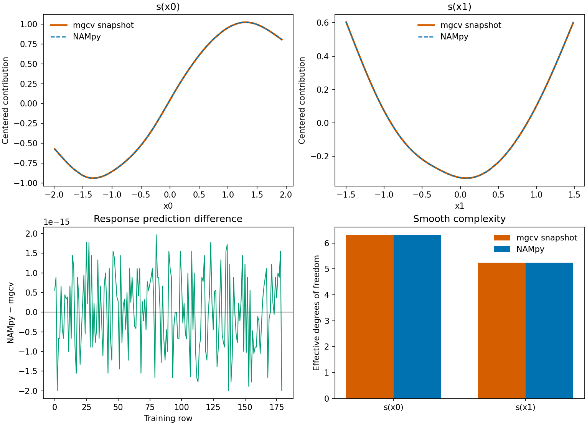

Coming from R's mgcv? Here's what you can do in Python.
=======================================================

``GAMRegressor`` is the Python estimator for the workflow you would write with ``mgcv::gam``. Fitting and prediction run in Python and do not require an R installation. The formula string uses the same smooth constructors, including ``bs`` and ``k``.

The adapter selects smoothing by REML unless ``smoothing_method`` is changed. The lower-level :class:`nampy.gam.GAM` class keeps smoothing fixed until automatic selection is requested. Use the adapter when you want ``gam(..., method="REML")``.

.. grid:: 1 2 2 2
   :gutter: 3

   .. grid-item::

      **R: mgcv**

      .. code-block:: r

         library(mgcv)

         model <- gam(
           y ~ s(x, bs = "cr", k = 12),
           data = data,
           method = "REML"
         )

         summary(model)
         predict(model, newdata = test)

   .. grid-item::

      **Python: NAMpy**

      .. code-block:: python

         from nampy.models import GAMRegressor

         model = GAMRegressor(
             formula="y ~ s(x, bs='cr', k=12)",
             smoothing_method="reml",
         ).fit(data)

         model.summary()
         model.predict(test)

A few direct translations:

.. list-table::
   :header-rows: 1
   :widths: 40 60

   * - mgcv
     - NAMpy
   * - ``gam(..., method="REML")``
     - ``GAMRegressor(..., smoothing_method="reml")``
   * - ``family=poisson()``
     - ``family="poisson"``
   * - ``offset(log(exposure))``
     - the same term inside the formula string
   * - ``summary(model)``
     - ``model.summary()``
   * - ``plot(model)``
     - ``model.plot()``
   * - ``predict(model, newdata, type="response")``
     - ``model.predict(newdata)``
   * - ``predict(model, newdata, type="terms")``
     - ``model.predict_components(newdata)``

Shape-constrained smooths follow scam basis codes such as ``bs="mpi"`` and are documented in :ref:`shape-constrained GAMs <howto-user-guide-shape-constrained-gams>`. The :doc:`statistical track <tutorials/track_statistical>` continues from here through families, uncertainty, and diagnostics.

One cubic-regression snapshot
-----------------------------

The figure uses the committed ``gaussian_cr_uni_reml`` fixture. The one-line example above is a separate translation, with one smooth and ``k=12``. The recorded formula is ``y ~ s(x0, bs="cr", k=8) + s(x1, bs="cr", k=8)``, fit by REML to 180 rows. The mgcv curves, EDF, and REML score are the stored snapshot. NAMpy is refit on those same rows in Python. The test suite does not call R for this comparison.

The smooth panels plot the centered term contributions. The dashed NAMpy curve lies on the mgcv snapshot. The difference panel is scaled in units of ``1e-15``. Variation on that scale is rounding of the fitted function. The EDF bars are the same height at the resolution of the axis.

.. include:: /_generated/mgcv_parity_gaussian_cr.inc

These are identified quantities for this basis and sample. A non-unique basis can match in the fitted function while its raw coefficients differ. The parity tests record the compared quantities and the tolerance used for each one.
