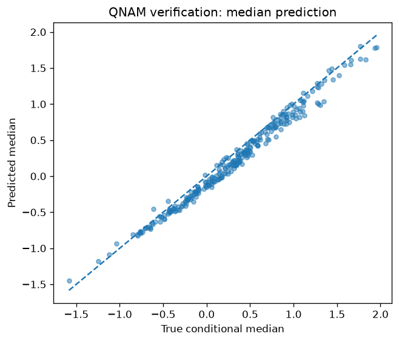

Conditional Quantiles and Interval Calibration
==============================================

Prerequisite: :doc:`../notebooks/04_distributional_models`. The complete
180-epoch script can take several minutes on CPU; early stopping may shorten
the run.

A mean prediction cannot tell us whether uncertainty changes with the inputs.
This example uses ``examples/example_qnam.py`` to fit the 10th, 50th, and 90th
conditional quantiles of a synthetic response with numerical and categorical
effects. Unlike a normal location-scale fit, the estimator targets quantiles
directly using pinball loss.

Generate data with known quantiles
----------------------------------

The simulation has additive location and positive additive scale:

.. math::

   Y = \mu(x) + \sigma(x)\epsilon,\qquad \epsilon\sim N(0,1),
   \qquad Q_\tau(Y\mid x)=\mu(x)+\Phi^{-1}(\tau)\sigma(x).

Knowing the conditional quantiles lets us assess recovery separately from the
random variation of observed outcomes. A real dataset would not provide this
reference; we would rely on held-out pinball loss and calibration instead.

.. code-block:: python

   import tempfile
   import numpy as np
   import pandas as pd
   import torch
   from sklearn.model_selection import train_test_split
   from nampy.models import QNAMLSS

.. literalinclude:: ../../examples/example_qnam.py
   :language: python
   :start-after: def main():
   :end-before: # Fit QNAM
   :dedent: 4

Fit ordered quantiles
----------------------

For residual :math:`u=y-q_\tau(x)`, pinball loss is
:math:`\rho_\tau(u)=u\{\tau-\mathbf{1}(u<0)\}`. Each quantile penalizes
underprediction and overprediction differently. QNAM parameterizes ordered
outputs, so adjacent quantiles cannot cross; this constraint does not by
itself establish calibration. The family loss sums the contributions from
the requested quantile levels and averages over observations.

.. literalinclude:: ../../examples/example_qnam.py
   :language: python
   :start-after: # Fit QNAM
   :end-before: # Predictions
   :dedent: 4

Evaluate coverage and interval width
------------------------------------

Predictions have one column per requested quantile. The fraction of held-out
outcomes below the 10th percentile should be close to 0.1, and likewise for
the other levels. The interval between the 10th and 90th percentiles targets
80% coverage. Coverage and width should be read together: a very wide interval
can cover most outcomes while being uninformative.

.. code-block:: python

   prediction = np.asarray(model.predict(X_test))
   for column, quantile in enumerate(quantiles):
       coverage = np.mean(y_test <= prediction[:, column])
       print(f"Quantile {quantile:.1f}: coverage {coverage:.3f}")

   lower, median, upper = prediction.T
   print("Interval coverage:", np.mean((y_test >= lower) & (y_test <= upper)))
   print("Mean interval width:", np.mean(upper - lower))

Overall coverage can conceal poorly calibrated subgroups. Repeat these checks
within regions or ranges of age when those comparisons have enough data.
The script reserves 60% of rows for training, 20% for early stopping, and
20% for these final test-set checks.

Interpret quantile-specific effects
-----------------------------------

A feature can affect the median and the tails differently. ``predict_components``
returns contributions with a quantile dimension; categorical terms may be
returned as a source-level term or encoded level terms. The complete script
handles both forms when comparing the learned region effects with truth.

.. code-block:: python

   components = model.predict_components(X_test)
   for name, contribution in components.terms.items():
       print(name, np.asarray(contribution).shape)

This saved repository figure compares the predicted median with its known
conditional value. Agreement with the diagonal concerns median recovery;
it does not establish tail coverage. The coverage calculation above answers
that separate question.

:download:`Download the complete example <../../examples/example_qnam.py>`
includes the quantile-by-quantile truth comparison, categorical effect
aggregation, and plotting code. Continue with :doc:`../notebooks/04_distributional_models`
for the distinction between quantile intervals and ensemble disagreement.
