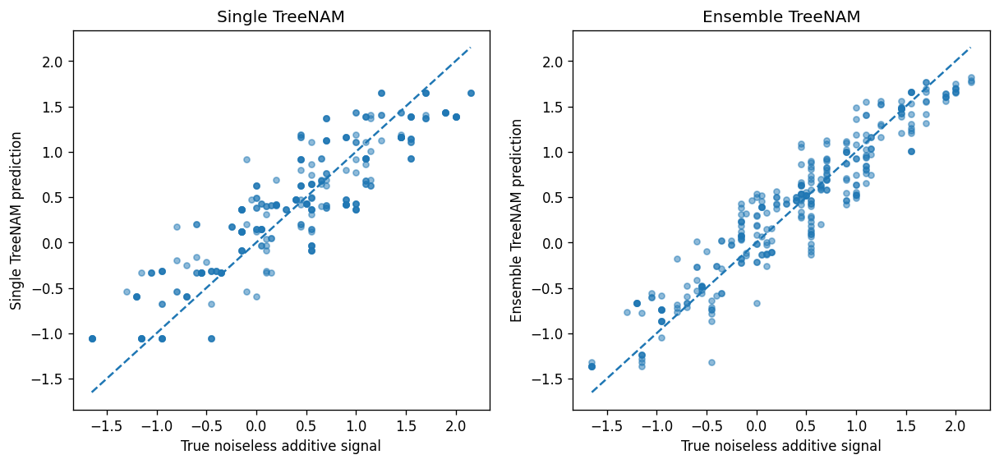

Recover Step Effects with Additive Trees
========================================

Smooth feature functions are not always a natural representation. A response
may change around thresholds or between category levels. The repository's
``examples/example_ensemble.py`` compares a single TreeNAM with an
EnsembleTreeNAM on a known piecewise-additive signal.

Construct numerical steps and categorical shifts
------------------------------------------------

The response is generated as
:math:`y=f_{\rm age}(\mathrm{age})+f_{\rm income}(\mathrm{income})+u_{\rm region}+\epsilon`.
The numerical functions are constant within intervals, and each region has a
fixed shift. Because the functions are known, the example can compare both
prediction quality and recovery of individual effects.

.. code-block:: python

   import tempfile
   import numpy as np
   import pandas as pd
   from sklearn.model_selection import train_test_split
   from nampy.models import TreeNAMRegressor, EnsembleTreeNAMRegressor

.. literalinclude:: ../../examples/example_ensemble.py
   :language: python
   :lines: 31-86
   :dedent: 4

Compare single and jointly trained trees
----------------------------------------

A soft tree routes an observation through probabilistic gates instead of
hard branches. For example, :math:`q(x)=\mathrm{sigmoid}\{a(x_j-t)\}`
softens a split around threshold :math:`t`. Depth controls the number of
regions a tree can represent. Hard routing at evaluation makes the final
partition more discrete.

The ensemble averages member contributions while training the members
jointly. This is a representation choice; it is different from independently
fitting bootstrap members with ``NeuralEnsemble``. Variation between jointly
trained trees is not automatically a measure of prediction uncertainty.

.. literalinclude:: ../../examples/example_ensemble.py
   :language: python
   :lines: 91-142
   :dedent: 4

Read prediction quality and effect recovery separately
-------------------------------------------------------

.. code-block:: python

   from sklearn.metrics import mean_absolute_error, r2_score

   for name, model in [("Single tree", single_model), ("Joint ensemble", ensemble_model)]:
       prediction = model.predict(X_val)
       print(name, "MAE:", mean_absolute_error(y_val, prediction))
       print(name, "R2:", r2_score(y_val, prediction))
       components = model.predict_components(X_val)

Low held-out error indicates useful prediction, but does not guarantee that
each feature effect has been recovered. Additive terms have a constant-shift
ambiguity, so the script centers learned and true effects before comparing
their shapes. Region-level contributions are aggregated when preprocessing
represents the category with several encoded terms.

In the saved repository figure, compare the locations and sizes of numerical
steps and the relative shifts between categories. Soft transitions can blur a
true discontinuity; deeper trees can also follow noise. The result is a
worked example of a suitable representation, not evidence that a tree
ensemble always improves on a single tree.

The validation split in the script is also used for early stopping. Reserve a
separate test set when reporting final performance after model selection.

:download:`Download the complete example <../../examples/example_ensemble.py>`
for the effect alignment, category aggregation, and figure construction.
See :doc:`../models/treenam` and :doc:`../models/ensemble_treenam` for the
architecture controls.
