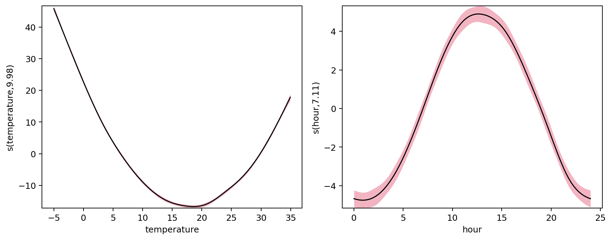

NAMpy: Additive Modeling in Python
==================================

NAMpy brings statistical generalized additive models and neural additive
models into one Python library. Fit flexible predictors with formulas or
estimator classes, then inspect the feature effects behind each prediction.

.. container:: homepage-actions

   .. button-ref:: quickstart
      :color: primary

      Fit your first GAM

   .. button-ref:: neural_quickstart
      :outline:

      Fit your first neural additive model

Install the complete package with ``pip install nampy``. If you already use
``mgcv`` or ``scam``, see the :doc:`compatibility guide <compatibility>`.

See what the model learned
--------------------------

This statistical GAM estimates how temperature and time of day relate to
energy demand in a synthetic dataset. The curves are feature contributions;
the shaded regions show pointwise uncertainty. Together with the intercept,
the contributions reconstruct the model prediction.

Two ways to build additive models
---------------------------------

.. grid:: 1 1 2 2
   :gutter: 2

   .. grid-item-card:: Statistical GAMs
      :link: quickstart
      :link-type: doc

      Fit penalized smooths entirely in Python, select their complexity
      automatically, quantify uncertainty, and diagnose the fitted model.

      **Start with:** :doc:`Fit your first GAM <quickstart>`

   .. grid-item-card:: Neural additive models
      :link: neural_quickstart
      :link-type: doc

      Learn flexible feature functions with neural networks while retaining
      named contributions that can be plotted and inspected.

      **Start with:** :doc:`Fit your first neural additive model
      <neural_quickstart>`

Capabilities that extend the analysis
-------------------------------------

Shape constraints and distributional regression are not separate modeling
worlds. Constraints extend statistical smooths; distributional regression can
be used with statistical or neural additive predictors.

.. grid:: 1 1 2 2
   :gutter: 2

   .. grid-item-card:: Shape-constrained effects
      :link: user_guide/shape_constrained_gams
      :link-type: doc

      Encode increasing, decreasing, convex, concave, positive, local, or
      bivariate shape assumptions when the subject matter supports them.

   .. grid-item-card:: Distributional modeling
      :link: user_guide/gamlss
      :link-type: doc

      Model changing spread and other distribution parameters alongside
      location instead of reducing every conditional distribution to one mean.

Compatibility and validation
----------------------------

NAMpy's Python-native statistical engine follows ``mgcv`` as its main
methodological reference and ``scam`` for shape-constrained smooths.
Versioned comparisons cover representative design matrices, penalties,
estimates, predictions, uncertainty quantities, and diagnostics. The
:doc:`compatibility and validation page <compatibility>` states what is
implemented, compared, intentionally different, and unsupported.

.. toctree::
   :maxdepth: 1
   :hidden:

   getting_started
   user_guide
   examples/index
   api/index
   about
