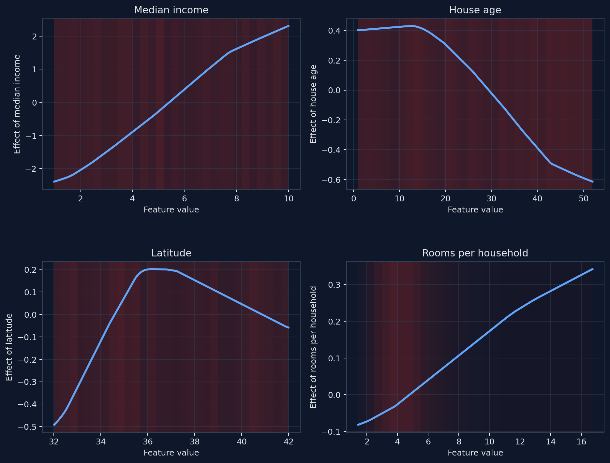

NAMpy: Interpretable Additive Modeling
======================================

NAMpy is a Python library for statistical and neural additive models. Models
can be specified with formulas, such as ``y ~ s(x) + te(z1, z2)``, or through
Python estimator classes with familiar ``fit`` and ``predict`` methods. Both
interfaces provide access to additive terms, feature effects, interactions,
and distributional parameters while preserving the estimation and
interpretation appropriate to each model family.

Use :class:`nampy.gam.GAM` when the model is most naturally expressed as a
formula. Use estimators such as :class:`nampy.models.GAMRegressor` and
:class:`nampy.models.NAMRegressor` when working with feature matrices and
scikit-learn-style workflows.

Neural additive models
----------------------

A neural additive model represents the transformed conditional mean as a sum
of feature functions,

.. math::

   \eta(x) \equiv g\!\left(\mathbb{E}[Y \mid x]\right)
   = \beta_0 + \sum_{j=1}^{p} f_j(x_j).

Each :math:`f_j` is a small neural network that receives one feature and learns
its possibly nonlinear contribution. The model remains inspectable because a
prediction is obtained by adding these contributions. Explicit interaction
terms can be included when an effect should depend on more than one feature.
NAMpy can center the terms against reference data for display; this fixes their
vertical position without claiming that correlated feature effects are
uniquely identifiable.

Installation
------------

.. code-block:: bash

   pip install nampy

NAMpy supports Python 3.11 and 3.12. The standard installation contains the
statistical and neural backends. See :doc:`installation` for hardware guidance
and verification.

A first neural additive model
-----------------------------

This complete example learns four nonlinear feature functions. The plotting
call uses the same public term-contribution API for all neural additive
estimators.

.. code-block:: python

   import numpy as np
   import pandas as pd

   from nampy.models import NAMRegressor

   rng = np.random.default_rng(7)
   n = 1_800
   X = pd.DataFrame({
       "median_income": rng.uniform(1.0, 10.0, n),
       "house_age": rng.uniform(1.0, 52.0, n),
       "latitude": rng.uniform(32.0, 42.0, n),
       "rooms_per_household": rng.lognormal(1.5, 0.35, n),
   })
   y = (
       2.2 * np.tanh((X["median_income"] - 5.0) / 1.7)
       + 0.9 * np.sin((X["house_age"] - 5.0) / 8.0)
       - 0.55 * (X["latitude"] - 37.0) ** 2 / 6.0
       + 0.75 * np.log1p(X["rooms_per_household"])
       + rng.normal(0.0, 0.3, n)
   )

   model = NAMRegressor(
       layer_sizes=[48, 24],
       dropout=0.0,
       numerical_preprocessing="minmax",
   )
   model.fit(
       X,
       y,
       max_epochs=100,
       batch_size=128,
       patience=12,
       random_state=7,
   )
   figures = model.plot_terms(
       X,
       center=True,
       reference_X=X,
       pages=1,
   )

.. image:: _static/homepage_demo_light.png
   :alt: Four feature-effect plots learned by a NAMpy neural additive model
   :class: homepage-demo homepage-demo-light
   :align: center

Each curve is one centered contribution :math:`f_j(x_j)` on the additive
predictor scale. The reddish shading shows the empirical density of each
feature. Adding the four displayed terms and the adjusted intercept
reconstructs the model prediction; the curves are not marginal correlations
with the response.

Why NAMpy
---------

* **One workflow, two modeling traditions.** Use statistical GAMs and neural
  additive models without learning unrelated estimator interfaces.
* **Inspectable predictions.** Recover term contributions, feature effects,
  importances, and distributional parameters through public methods.
* **Models for different assumptions.** Choose smooth functions, shape
  constraints, neural feature networks, explicit interactions, or
  distributional objectives.
* **Tabular data support.** Work with numerical and categorical columns through
  the package's preprocessing layer.

Choose a starting point
-----------------------

.. grid:: 1 1 2 2
   :gutter: 2

   .. grid-item-card:: Statistical GAMs
      :link: notebooks/02_statistical_gams
      :link-type: doc

      Fit penalized smooths, select smoothing parameters, inspect uncertainty,
      and work with shape constraints.

   .. grid-item-card:: Neural models
      :link: notebooks/03_neural_models
      :link-type: doc

      Compare neural feature functions and interaction structures through the
      shared estimator interface.

   .. grid-item-card:: Distributional regression
      :link: notebooks/04_distributional_models
      :link-type: doc

      Model several distribution parameters and inspect how covariates affect
      location, scale, and shape.

   .. grid-item-card:: API reference
      :link: api/index
      :link-type: doc

      Find public estimators, configuration objects, distributions, plotting
      functions, and exact method signatures.

Documentation
-------------

The :doc:`overview` explains the model families and their shared interface.
The :doc:`quickstart` gives a complete first analysis. Use the
:doc:`notebook_tutorials` for executable workflows, the :doc:`user_guide` for
concepts, and the :doc:`api/index` for signature-level reference.

.. toctree::
   :caption: Getting Started
   :maxdepth: 1
   :hidden:

   overview
   installation
   quickstart
   faq

.. toctree::
   :caption: Core Concepts
   :maxdepth: 2
   :hidden:

   user_guide

.. toctree::
   :caption: Tutorials and Examples
   :maxdepth: 2
   :hidden:

   notebook_tutorials
   examples/index

.. toctree::
   :caption: Models
   :maxdepth: 1
   :hidden:

   models/index

.. toctree::
   :caption: API Reference
   :maxdepth: 2
   :hidden:

   api/index

.. toctree::
   :caption: Developer Guide
   :maxdepth: 1
   :hidden:

   contributing
   architecture
   development/reference_sources
   development/mgcv_optimizer_boundaries
   license
