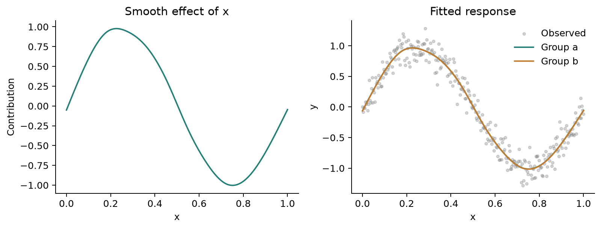
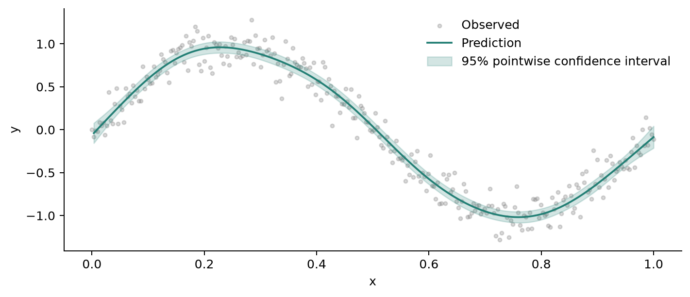
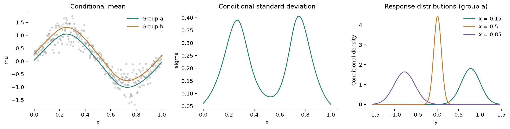
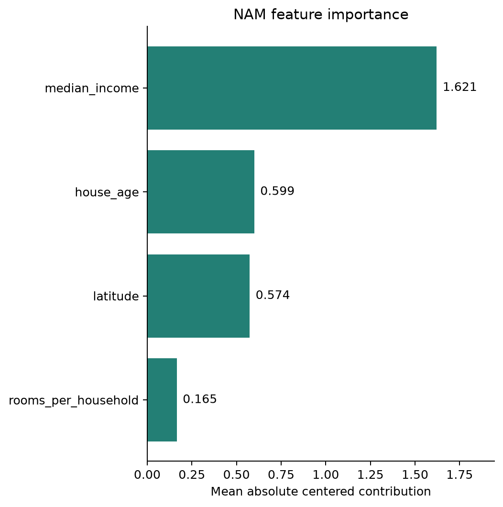

NAMpy: Interpretable Additive Models
====================================

.. image:: _static/logo.png
   :alt: NAMpy — Interpretable Additive Modeling
   :class: landing-logo no-scaled-link
   :align: center
   :width: 100%

NAMpy combines statistical and neural additive models in one Python workflow.
Fit nonlinear feature effects, inspect their contributions, and model changing
response distributions through a scikit-learn-style estimator interface.

Quick installation
------------------

.. code-block:: bash

   pip install nampy

For Python compatibility, installation checks, and GPU setup, see the :doc:`FAQ <faq>`.

Additive models
---------------

An additive model builds its prediction from one effect per feature:

.. math::

   \eta(x)=\beta_0+\sum_{j=1}^{p}f_j(x_j).

Here :math:`\beta_0` is the intercept and :math:`f_j` describes how feature
:math:`x_j` contributes. GAMs represent these effects with penalized splines;
neural additive models learn them with feature networks or other learned
functions. The inverse link maps the additive predictor to the conditional mean:

.. math::

   \mu(x)=\mathbb{E}[Y\mid x]=g^{-1}\!\left(\eta(x)\right).

For distributional regression, each distribution parameter gets its own
additive predictor:

.. math::

   \eta_k(x)=\beta_{0k}+\sum_{j=1}^{p}f_{jk}(x_j),
   \qquad \theta_k(x)=h_k^{-1}\!\left(\eta_k(x)\right).

.. math::

   Y\mid x\sim\mathcal D\!\left(\theta_1(x),\ldots,\theta_K(x)\right).

This lets quantities such as the conditional mean and spread vary with the
inputs. Contributions add on each predictor's link scale.

Quick start — Fitting a model
-----------------------------

Estimators provide ``fit``, ``predict``, and ``score`` methods and work with
scikit-learn cross-validation and hyperparameter search.

Generalized Additive Model (GAM)
~~~~~~~~~~~~~~~~~~~~~~~~~~~~~~~~

The estimator adapters default to automatic REML smoothness selection.

.. code-block:: python

   import numpy as np
   import pandas as pd

   from nampy.models import GAMRegressor

   rng = np.random.default_rng(7)
   x = np.linspace(0.0, 1.0, 300)
   data = pd.DataFrame(
       {
           "x": x,
           "group": rng.choice(["a", "b"], size=x.size),
           "y": np.sin(2 * np.pi * x) + rng.normal(scale=0.15, size=x.size),
       }
   )

   model = GAMRegressor(
       formula="y ~ s(x, bs='cr', k=12) + group",
       smoothing_method="reml",
   ).fit(data)

   prediction = model.predict(data)
   summary = model.summary()
   components = model.predict_components(data)

.. include:: _generated/home_gam.inc

Without a formula, the adapter creates one smooth main effect per input column:

.. code-block:: python

   X_train = data[["x"]].iloc[::2]
   y_train = data["y"].iloc[::2]
   X_test = data[["x"]].iloc[1::2]

   model = GAMRegressor(k=10, basis="tp").fit(X_train, y_train)
   prediction = model.predict(X_test)
   standard_error = model.standard_errors(X_test)

.. include:: _generated/home_gam_adapter.inc

Distributional GAM (GAMLSS)
~~~~~~~~~~~~~~~~~~~~~~~~~~~

Fit separate predictors for the conditional mean and standard deviation:

.. code-block:: python

   from nampy.models import GAMLSS

   rng_dist = np.random.default_rng(11)
   data_dist = data.copy()
   noise_scale = 0.08 + 0.30 * np.sin(2 * np.pi * data_dist["x"]) ** 2
   data_dist["y"] = (
       np.sin(2 * np.pi * data_dist["x"])
       + 0.25 * (data_dist["group"] == "b")
       + rng_dist.normal(scale=noise_scale)
   )

   model = GAMLSS(
       family="normal",
       formula={
           "mu": "y ~ s(x, bs='cr', k=10) + group",
           "sigma": "~ s(x, bs='cr', k=8)",
       },
   ).fit(data_dist)

   parameters = model.predict(data_dist)       # columns: mu, sigma
   point_prediction = model.predict_point(data_dist)
   raw_predictors = model.predict(data_dist, raw=True)

.. include:: _generated/home_gamlss.inc

Neural Additive Model (NAM)
~~~~~~~~~~~~~~~~~~~~~~~~~~~

.. code-block:: python

   import numpy as np
   import pandas as pd

   from nampy.models import NAMRegressor

   rng = np.random.default_rng(7)
   n = 1_800
   X = pd.DataFrame({
       "median_income": rng.uniform(1.0, 10.0, n),
       "house_age": rng.uniform(1.0, 52.0, n),
       "latitude": rng.uniform(32.0, 42.0, n),
       "rooms_per_household": rng.lognormal(1.5, 0.35, n),
   })
   y = (
       2.2 * np.tanh((X["median_income"] - 5.0) / 1.7)
       + 0.9 * np.sin((X["house_age"] - 5.0) / 8.0)
       - 0.55 * (X["latitude"] - 37.0) ** 2 / 6.0
       + 0.75 * np.log1p(X["rooms_per_household"])
       + rng.normal(0.0, 0.3, n)
   )

   model = NAMRegressor(
       layer_sizes=[48, 24],
       dropout=0.0,
       numerical_preprocessing="minmax",
   )
   model.fit(
       X,
       y,
       max_epochs=100,
       batch_size=128,
       patience=12,
       random_state=7,
   )

   prediction = model.predict(X)
   components = model.predict_components(X, center=True, reference_X=X)
   importance = model.term_importance(X, center=True, reference_X=X)
   figures = model.plot_terms(X, center=True, reference_X=X)

.. image:: _static/homepage_demo_light.png
   :alt: Centered NAM feature effects for the four input features
   :class: homepage-demo scientific-figure
   :align: center

.. include:: _generated/home_nam.inc

Neural distributional regression
~~~~~~~~~~~~~~~~~~~~~~~~~~~~~~~~

Neural LSS estimators also provide point-and-spread effect plots:

.. code-block:: python

   from nampy.models import NAMLSS

   rng_dist = np.random.default_rng(11)
   X_dist = pd.DataFrame({
       "median_income": rng_dist.uniform(1.0, 10.0, n),
       "house_age": rng_dist.uniform(1.0, 52.0, n),
   })
   location = (
       1.8 * np.tanh((X_dist["median_income"] - 5.0) / 1.7)
       + 0.7 * np.sin((X_dist["house_age"] - 5.0) / 8.0)
   )
   scale = 0.25 + 0.45 / (1.0 + np.exp(-(X_dist["median_income"] - 5.0)))
   y_dist = location + rng_dist.normal(0.0, scale, n)

   lss = NAMLSS(
       family="normal",
       layer_sizes=[48, 24],
       dropout=0.0,
       numerical_preprocessing="minmax",
   )
   lss.fit(
       X_dist,
       y_dist,
       max_epochs=100,
       batch_size=128,
       patience=12,
       random_state=11,
   )
   figures = lss.plot_distributional_effects(
       X_dist,
       reference_X=X_dist,
       feature_names=["median_income", "house_age"],
       display_names={
           "median_income": "Median income",
           "house_age": "House age",
       },
   )

.. image:: _static/readme_distributional_effects.png
   :alt: Distributional feature effects with conditional spread and predictor density
   :class: homepage-demo scientific-figure
   :align: center

More modeling examples
----------------------

.. grid:: 1 1 2 2
   :gutter: 2

   .. grid-item-card:: Constrain a feature effect
      :link: tutorial-monotone
      :link-type: ref

      .. image:: _static/shape_constraint_comparison.png
         :alt: Comparison of unconstrained and monotone feature effects

      Encode a defensible monotonicity assumption during fitting.

   .. grid-item-card:: Model interacting features
      :link: tutorial-interaction
      :link-type: ref

      .. image:: _static/interaction_surface.png
         :alt: Joint spatial effect estimated by a tensor-product smooth

      Learn a joint surface that separate main effects cannot represent.

   .. grid-item-card:: Predict conditional quantiles
      :link: in_depth/quantile_calibration
      :link-type: doc

      .. image:: _static/detailed_quantile_median.png
         :alt: Learned and known conditional median in the QNAM example

      Compare quantile recovery, interval width, and held-out coverage.

   .. grid-item-card:: Recover step-shaped effects
      :link: in_depth/tree_effects
      :link-type: doc

      .. image:: _static/detailed_tree_effects.png
         :alt: Additive tree predictions and numerical and categorical effects

      Compare a single additive tree with a jointly trained tree ensemble.

Explore the documentation
-------------------------

.. grid:: 1 1 2 2
   :gutter: 2

   .. grid-item-card:: Fit your first GAM
      :link: tutorials/first_gam
      :link-type: doc

      Follow one nonlinear dataset through fitting, held-out evaluation,
      effect interpretation, and diagnostics.

   .. grid-item-card:: Read formulas visually
      :link: user_guide/formula_visual_reference
      :link-type: doc

      Match smooths, cycles, group curves, random effects, tensor products,
      and offsets to fitted examples.

   .. grid-item-card:: Understand additive models
      :link: concepts/index
      :link-type: doc

      Learn the statistical, neural, distributional, and interpretation
      foundations.

   .. grid-item-card:: Work through tutorials
      :link: tutorials/index
      :link-type: doc

      Explore question-led analyses with executable code and fitted plots.

   .. grid-item-card:: Look up an exact symbol
      :link: api/models
      :link-type: doc

      Find constructors, methods, defaults, return values, and extension
      interfaces.

   .. grid-item-card:: Explore detailed examples
      :link: in_depth/index
      :link-type: doc

      Work through longer statistical, neural, and distributional analyses.

   .. grid-item-card:: Choose a model
      :link: models/index
      :link-type: doc

      Compare model capabilities and find the estimator for your analysis.

   .. grid-item-card:: Find a practical recipe
      :link: howto/index
      :link-type: doc

      Find focused guides for preprocessing, fitting, interpretation, and prediction.

Contributors
------------

.. raw:: html

   

   <a class="contributor-profile" href="https://github.com/Ananyapam7">Ananyapam7</a>
   <a class="contributor-profile" href="https://github.com/AnFreTh">AnFreTh</a>
   <a class="contributor-profile" href="https://github.com/22GC22">22GC22</a>
   <a class="contributor-profile" href="https://github.com/eltociear">eltociear</a>
   

`All contributors on GitHub <https://github.com/OpenTabular/NAMpy/graphs/contributors>`_.

.. toctree::
   :caption: Getting Started
   :maxdepth: 2
   :hidden:

   Introductory examples <tutorials/index>
   Advanced examples <in_depth/index>
   faq

.. toctree::
   :caption: How-to Guides
   :maxdepth: 2
   :hidden:

   howto/index

.. toctree::
   :caption: Concepts
   :maxdepth: 2
   :hidden:

   concepts/index

.. toctree::
   :caption: Reference
   :maxdepth: 2
   :hidden:

   models/index
   user_guide/formula_visual_reference
   api/models
   api/gam
   api/gam_formula
   api/gam_smooths
   api/gam_families
   api/gam_diagnostics
   api/gam_inference
   api/gam_results
   api/gam_advanced
   api/basemodels
   api/configs
   api/utils
   api/neural
   api/contracts
   api/plotting

.. toctree::
   :caption: Development
   :maxdepth: 1
   :hidden:

   compatibility
   contributing
   development/validation_reports
   architecture
   development/reference_sources
   development/mgcv_optimizer_boundaries
   license
