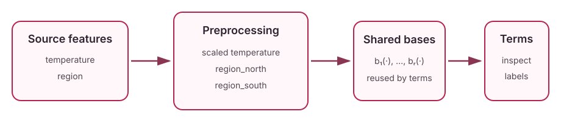

NBM
===

When to use it
--------------

Use NBM when several feature terms should reuse a learned bank of nonlinear
basis functions.

Model structure
---------------

Neural Basis Models learn a bank of nonlinear basis functions and reuse that
bank across feature terms. A term indexed by a feature subset :math:`S` has
the form

.. math::

   f_S(x_S) = \sum_{r=1}^{R} a_{Sr}\,b_r(x_S),

so representation learning occurs in the shared bases while term-specific
coefficients assemble the additive predictor. NAMpy supports unary and n-ary
terms, dense or sparse execution, and explicit interaction orders.

Fit and inspect
---------------

.. code-block:: python

   from nampy.neural.configs.nbm_config import DefaultNBMConfig
   from nampy.neural.configuration import GradientTrainingConfig
   from nampy.models import NBMRegressor

   model = NBMRegressor(architecture_config=DefaultNBMConfig(num_bases=100, interaction_degree=2, output_penalty=0.0001), training=GradientTrainingConfig(sparse=False)).fit(X_train, y_train)

   components = model.predict_components(X_test, center=True)
   effects = model.explain_terms(X_test)
   figures = model.plot_terms(X_test, center=True)

Interpretation and limits
-------------------------

Because encoded feature blocks are flattened into scalar concepts, inspect the
term labels when categorical preprocessing expands one source feature into
several columns.

Available estimators
--------------------

* :class:`nampy.models.NBMRegressor`
* :class:`nampy.models.NBMClassifier`
* :class:`nampy.models.NBMLSS`

Reference
---------

Radenovic, Dubey, and Mahajan (2022), `Neural Basis Models for
Interpretability <https://arxiv.org/abs/2205.14120>`_.

