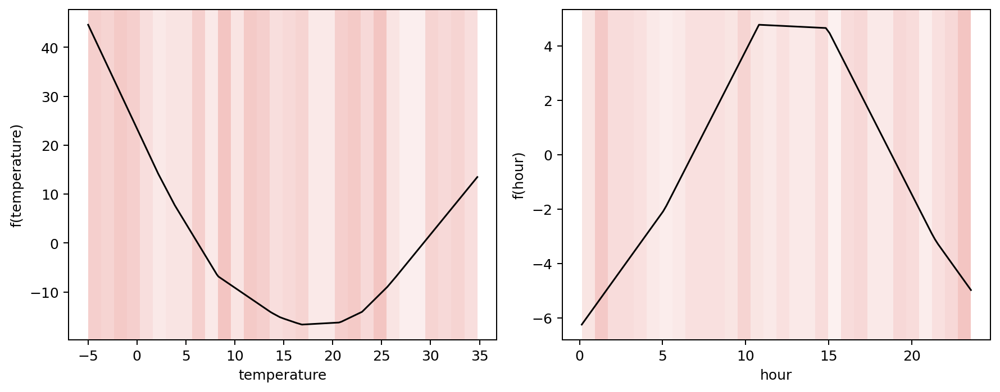

Fit and Interpret Your First Neural Additive Model
==================================================

This tutorial asks the same question as the statistical GAM tutorial: **how do
outdoor temperature and time of day relate to energy demand?** Here the feature
functions are learned by neural networks. We evaluate the model on unseen rows
and then inspect the contributions behind its predictions.

The dataset is synthetic, so its structure is known in advance.

Create the data
---------------

.. code-block:: python

   import numpy as np
   import pandas as pd
   from sklearn.model_selection import train_test_split

   rng = np.random.default_rng(21)
   n = 900
   temperature = rng.uniform(-5.0, 35.0, n)
   hour = rng.uniform(0.0, 24.0, n)
   demand = (
       45.0
       + 0.12 * (temperature - 18.0) ** 2
       + 5.0 * np.sin(2.0 * np.pi * (hour - 7.0) / 24.0)
       + rng.normal(0.0, 2.0, n)
   )

   X = pd.DataFrame({"temperature": temperature, "hour": hour})
   X_train, X_test, y_train, y_test = train_test_split(
       X, demand, test_size=0.2, random_state=21
   )

Fit one network per feature
---------------------------

``NAMRegressor`` assigns a small neural network to each input feature and adds
their outputs. Min--max preprocessing puts the two inputs on comparable
numeric ranges; it does not alter the values shown on the effect plots.

.. code-block:: python

   from nampy.models import NAMRegressor

   model = NAMRegressor(
       layer_sizes=[32, 16],
       dropout=0.0,
       numerical_preprocessing="minmax",
   )
   model.fit(
       X_train,
       y_train,
       max_epochs=180,
       patience=18,
       lr=1e-2,
       random_state=21,
   )

Evaluate unseen observations
----------------------------

.. code-block:: python

   from sklearn.metrics import mean_squared_error, r2_score

   predicted = model.predict(X_test)
   rmse = mean_squared_error(y_test, predicted) ** 0.5
   r2 = r2_score(y_test, predicted)
   print(f"RMSE: {rmse:.2f}")
   print(f"R²:   {r2:.3f}")

.. code-block:: text

   RMSE: 2.18
   R²:   0.986

Held-out metrics assess prediction on rows that were not used for fitting.
The effect plot then shows how each feature contributes to those predictions.

Inspect the learned effects
---------------------------

.. code-block:: python

   figures = model.plot_terms(
       X_test,
       center=True,
       reference_X=X_train,
       figsize=(10, 4),
   )

The vertical axis is a centered contribution to the additive predictor. The
reddish background shows where training observations are concentrated; it is
not an uncertainty interval. The model recovers the U-shaped temperature
effect and the daily pattern without receiving their equations.

Unlike the cyclic spline in the GAM tutorial, an ordinary NAM does not impose
equal values at the start and end of the day. If that boundary condition is
scientifically important, use the statistical cyclic smooth or encode the
periodic input deliberately.

Check the decomposition
-----------------------

.. code-block:: python

   components = model.predict_components(
       X_test,
       center=True,
       reference_X=X_train,
   )
   components.validate_additive_reconstruction()
   print(components.terms.keys())

The reconstruction check verifies that the returned intercept, offset, and
named terms add back to the link-scale prediction. It does not claim that the
estimated effects are unique or stable under correlated predictors.

Continue the analysis
---------------------

* :doc:`user_guide/neural_models` explains neural additive terms, training,
  preprocessing, and interactions.
* :doc:`models/index` starts with NAM and then compares the other neural
  architectures.
* :doc:`user_guide/interpretability` defines centering, density shading, and
  the shared prediction contract.
* :doc:`examples/index` collects tutorials, focused recipes, and extended
  notebooks in one gallery.
