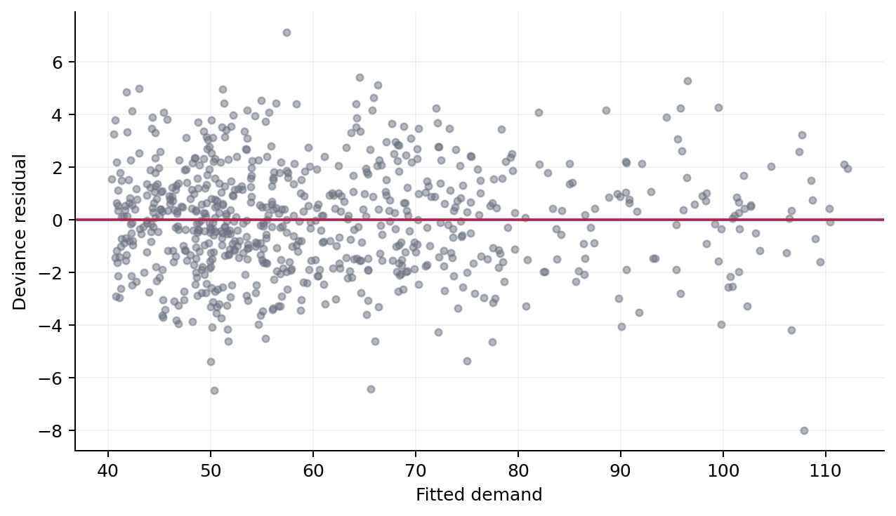

Fit and Interpret Your First GAM
================================

This tutorial asks a concrete question: **how do outdoor temperature and time
of day relate to energy demand?** We will fit a statistical GAM, evaluate it on
unseen observations, inspect the estimated effects, and check whether the
chosen basis dimensions are adequate.

The data in this tutorial are synthetic. Their meaningful column names make
the model easier to discuss without presenting the example as a real energy
study.

Create one nonlinear dataset
----------------------------

Demand increases at unusually low and high temperatures and follows a daily
cycle. Random noise makes the fitted effects uncertain rather than perfectly
known.

.. code-block:: python

   import numpy as np
   import pandas as pd
   from sklearn.model_selection import train_test_split

   rng = np.random.default_rng(21)
   n = 900

   temperature = rng.uniform(-5.0, 35.0, n)
   hour = rng.uniform(0.0, 24.0, n)
   demand = (
       45.0
       + 0.12 * (temperature - 18.0) ** 2
       + 5.0 * np.sin(2.0 * np.pi * (hour - 7.0) / 24.0)
       + rng.normal(0.0, 2.0, n)
   )

   data = pd.DataFrame(
       {"demand": demand, "temperature": temperature, "hour": hour}
   )
   train, test = train_test_split(data, test_size=0.2, random_state=21)

Choose the terms and fit the model
----------------------------------

Temperature receives a cubic regression spline. Hour receives a cyclic cubic
spline because midnight and the end of the day are the same boundary. The
basis dimension ``k`` supplies enough capacity for each curve; REML determines
how much of that capacity the fitted model uses.

.. code-block:: python

   from nampy.models import GAMRegressor

   model = GAMRegressor(
       formula=(
           'demand ~ s(temperature, bs="cr", k=12) '
           '+ s(hour, bs="cc", k=12)'
       ),
       family="gaussian",
   )
   model.fit(train)

``GAMRegressor`` follows estimator conventions and automatically selects
smoothness with REML by default. The lower-level :class:`nampy.gam.GAM` offers
more direct control and defaults to fixed smoothing; set
``optimize_smoothing=True`` when automatic selection is wanted there. Both
interfaces accept formulas.

Evaluate unseen observations
----------------------------

.. code-block:: python

   from sklearn.metrics import mean_squared_error, r2_score

   predicted = model.predict(test)
   rmse = mean_squared_error(test["demand"], predicted) ** 0.5
   r2 = r2_score(test["demand"], predicted)
   print(f"RMSE: {rmse:.2f}")
   print(f"R²:   {r2:.3f}")

.. code-block:: text

   RMSE: 1.95
   R²:   0.989

These values describe prediction on the held-out rows. They do not by
themselves establish that the smooth terms are well specified, so the next
steps inspect the fitted model directly.

Interpret the effects
---------------------

.. code-block:: python

   plot_data = model.plot(
       pages=1,
       scheme=1,
       shade_col="#f3b4c2",
       scale=0,
       figsize=(10, 4),
   )

.. image:: _static/first_gam_effects.png
   :alt: Estimated temperature and hour effects with uncertainty
   :class: scientific-figure
   :align: center

The solid curves are centered term contributions on the additive-predictor
scale. The shaded bands are pointwise uncertainty intervals. Temperature has a
U-shaped effect: demand is lowest around mild temperatures and rises toward
both extremes. The hour effect is periodic, and the cyclic basis makes the
curve meet at the day boundary.

Recover the additive pieces
---------------------------

NAMpy exposes more than a final prediction. The shared result object contains
the link-scale prediction, response prediction, intercept, named terms, and
offset.

.. code-block:: python

   components = model.predict_components(test)
   components.validate_additive_reconstruction()

   print(components.terms.keys())

.. code-block:: text

   dict_keys(['s(temperature, bs="cr", k=12)',
              's(hour, bs="cc", k=12)'])

Passing the reconstruction check means that the reported terms, intercept,
and offset add back to the model's linear predictor. It is an accounting
guarantee, not a claim that effects are uniquely identified under correlated
predictors.

Check the fitted smooths
------------------------

Start with the model summary and a residual plot. The adapter keeps the fitted
statistical model in ``gam_``, which exposes the full diagnostic surface.

.. code-block:: python

   import matplotlib.pyplot as plt

   fitted = model.predict(train)
   residual = model.gam_.residuals(type="deviance")

   plt.scatter(fitted, residual, s=15, alpha=0.5)
   plt.axhline(0.0, color="#b4234d")
   plt.xlabel("Fitted demand")
   plt.ylabel("Deviance residual")

The residuals remain centered without a strong fitted-value pattern. That
does not prove the model is correct, but a trend or changing vertical spread
would motivate revisiting the terms or response distribution.

Next inspect whether either basis appears too small for remaining structure.

.. code-block:: python

   model.summary()
   basis_check = model.gam_.k_check(n_rep=20, seed=21)
   print(basis_check)

.. code-block:: text

                   k_prime    edf  k_index  p_value
   label
   s(temperature)        11  9.977     1.028     0.75
   s(hour)               10  7.114     1.001     0.70

Here the effective degrees of freedom remain within the available basis and
the diagnostic gives no evidence that either ``k`` is too restrictive. This
is not a universal acceptance test: residual structure, the scientific
meaning of each term, and sensitivity to model choices still matter.

Choose the next analysis
------------------------

* :doc:`user_guide/statistical_gams` lists formulas, smooth bases, families,
  fitting controls, prediction options, inference, and diagnostics.
* :doc:`user_guide/shape_constrained_gams` shows how to impose a defensible
  monotonicity, curvature, or positivity assumption.
* :doc:`models/index` helps choose a neural additive architecture.
* :doc:`user_guide/gamlss` models changing spread and other distribution
  parameters.
* :doc:`compatibility` documents the supported ``mgcv`` and ``scam``
  compatibility surface and its boundaries.
