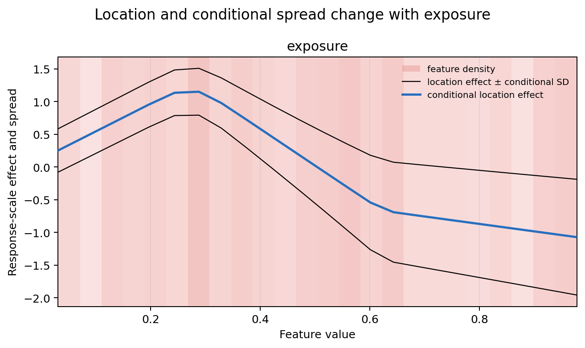

Model Changing Conditional Variability
======================================

Two observations can have the same expected response but very different
uncertainty. Here the conditional location varies nonlinearly with exposure,
while the observation-level standard deviation grows across its range.

.. code-block:: python

   from nampy.models import NAMLSS

   model = NAMLSS(
       family="normal",
       layer_sizes=[24, 12],
       dropout=0.0,
       numerical_preprocessing="minmax",
   ).fit(X, y, max_epochs=30, lr=1e-2, random_state=29)

   figures = model.plot_distributional_effects(
       X,
       reference_X=X,
       feature_names=["exposure"],
       point_label="conditional location effect",
       envelope_label="location effect ± conditional SD",
   )

The blue curve is the change in the family-defined conditional point
prediction relative to the centered reference configuration. The black curves
are that point effect plus and minus one conditional standard deviation. They
describe predictive spread, not uncertainty about the fitted mean. The red
background indicates where observations are concentrated. With repeated
fits, an additional blue ribbon can show between-fit variation; it has a
different interpretation from the black envelope.

All quantities are on the response scale. ``reference_X=X`` centers terms
against the empirical training distribution; setting every centered term to
zero defines a synthetic reference configuration and need not correspond to
an observed row. See :doc:`../user_guide/gamlss` for parameter links and
family-specific meanings.
