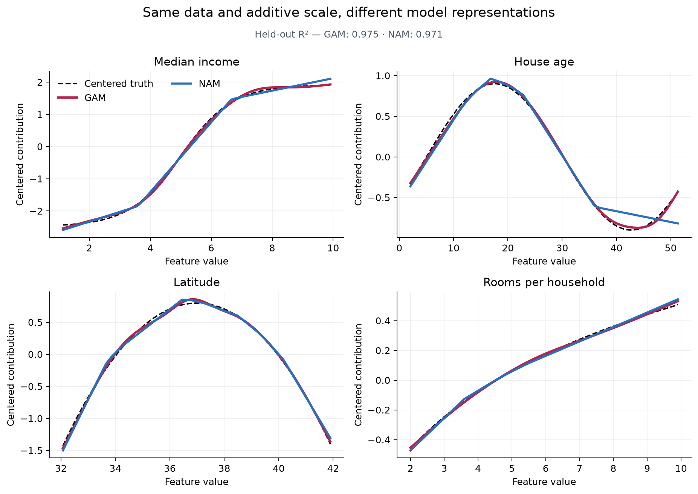

Compare GAM, NAM, and shared-basis models
=========================================

This analysis builds on :doc:`first_gam` and the shared estimator workflow.
Allow several minutes on CPU for the neural fits; the training budgets are
shown explicitly in the code.

Do a statistical GAM and a neural additive model learn the same relationships
when the data and train/test split are held fixed? This analysis fits both
representations to a four-feature synthetic housing dataset, evaluates them on
the same held-out rows, and compares every learned feature effect.

Create data with four nonlinear effects
---------------------------------------

The response combines saturating, periodic, quadratic, and logarithmic
relationships. Because the data are synthetic, each predictor has a known role
without presenting the example as a real housing study.

.. code-block:: python

   import numpy as np
   import pandas as pd
   from sklearn.model_selection import train_test_split

   rng = np.random.default_rng(41)
   n = 1_200
   data = pd.DataFrame({
       "median_income": rng.uniform(1.0, 10.0, n),
       "house_age": rng.uniform(1.0, 52.0, n),
       "latitude": rng.uniform(32.0, 42.0, n),
       "rooms_per_household": rng.lognormal(1.5, 0.35, n),
   })
   data["value"] = (
       2.2 * np.tanh((data["median_income"] - 5.0) / 1.7)
       + 0.9 * np.sin((data["house_age"] - 5.0) / 8.0)
       - 0.55 * (data["latitude"] - 37.0) ** 2 / 6.0
       + 0.75 * np.log1p(data["rooms_per_household"])
       + rng.normal(0.0, 0.3, n)
   )

   train, test = train_test_split(data, test_size=0.2, random_state=41)
   features = [
       "median_income",
       "house_age",
       "latitude",
       "rooms_per_household",
   ]

Fit both representations
------------------------

The GAM uses a cubic regression smooth for every predictor and selects the
smoothness by REML. The NAM uses an independent neural network for every
source feature. Both models are additive, but their function classes,
regularization, and fitting algorithms remain different.

.. code-block:: python

   from nampy.models import GAMRegressor, NAMRegressor

   gam = GAMRegressor(
       formula=(
           "value ~ s(median_income, bs='cr', k=12)"
           " + s(house_age, bs='cr', k=12)"
           " + s(latitude, bs='cr', k=12)"
           " + s(rooms_per_household, bs='cr', k=12)"
       ),
       family="gaussian",
   ).fit(train)

   nam = NAMRegressor(
       layer_sizes=[48, 24],
       dropout=0.0,
       numerical_preprocessing="minmax",
   )
   nam.fit(
       train[features],
       train["value"],
       max_epochs=60,
       lr=5e-3,
       batch_size=128,
       patience=10,
       random_state=41,
   )

Evaluate the same held-out rows
-------------------------------

``score`` returns :math:`R^2` for both regressors, so the predictive comparison
does not require task-specific adapter code.

.. code-block:: python

   scores = {
       "GAM": gam.score(test, test["value"]),
       "NAM": nam.score(test[features], test["value"]),
   }

These scores answer whether each model predicts the held-out response. They do
not show whether the models learned the same decomposition, so inspect their
components next.

Check the shared additive contract
----------------------------------

The GAM returns spline terms and the NAM returns feature-network terms through
the same :class:`nampy.contracts.AdditivePrediction` type. The neural effects
are centered against the training rows so their arbitrary additive constants
are transferred to the intercept.

.. code-block:: python

   gam_parts = gam.predict_components(test)
   nam_parts = nam.predict_components(
       test[features],
       center=True,
       reference_X=train[features],
   )

   gam_parts.validate_additive_reconstruction()
   nam_parts.validate_additive_reconstruction(atol=1e-5)

The neural check allows small floating-point rounding differences.
For each model, its intercept, named terms, and optional offset reconstruct the
linear predictor. This is an accounting guarantee. It does not imply that the
individual effects are uniquely identified or that neural effects carry the
GAM's inferential interpretation.

Compare every feature
---------------------

The curves below are centered link-scale contributions evaluated across each
feature's training range. Every other feature is held at its training median;
because these models contain main effects only, the selected value of the
other predictors does not change the plotted term.

.. code-block:: python

   import matplotlib.pyplot as plt

   # Match each named term to its source feature.
   def feature_effect(parts, feature):
       key = next(name for name in parts.terms if feature in name)
       return np.asarray(parts.terms[key]).reshape(-1)

   gam_reference = gam.predict_components(train)
   figure, axes = plt.subplots(2, 2, figsize=(10, 7))
   for axis, feature in zip(axes.flat, features):
       lower, upper = np.quantile(train[feature], [0.01, 0.99])
       values = np.linspace(lower, upper, 240)
       grid = pd.DataFrame({name: np.full(values.size, train[name].median()) for name in features})
       grid[feature] = values
       gam_effect = feature_effect(gam.predict_components(grid), feature)
       gam_effect -= feature_effect(gam_reference, feature).mean()
       nam_grid = nam.predict_components(grid, center=True, reference_X=train[features])
       axis.plot(values, gam_effect, label="GAM")
       truth = {
           "median_income": lambda x: 2.2*np.tanh((x-5)/1.7),
           "house_age": lambda x: .9*np.sin((x-5)/8),
           "latitude": lambda x: -.55*(x-37)**2/6,
           "rooms_per_household": lambda x: .75*np.log1p(x),
       }[feature]
       axis.plot(values, truth(values)-truth(train[feature]).mean(), "k--", label="Centered truth")
       axis.plot(values, feature_effect(nam_grid, feature), label="NAM")
       axis.set(title=feature, xlabel="Feature value", ylabel="Centered contribution")
   axes[0, 0].legend()
   figure.tight_layout()

Dashed truth is centered against the same training rows as the fitted curves.
Use it to assess recovery rather than the visual smoothness of a fitted line.
Both models recover the dominant saturating income effect, the curved latitude
effect, the age pattern, and the diminishing return from additional rooms.
Where the curves differ, the disagreement is useful information: spline basis
dimension and REML regularization govern the GAM, while network capacity,
optimization, and early stopping govern the NAM.

Use the comparison responsibly
------------------------------

The shared workflow makes representation sensitivity visible without erasing
important distinctions. Use the GAM when statistical smoothness selection,
standard errors, hypothesis tests, and diagnostics matter. Use the NAM when
feature-specific neural functions are the desired representation. Compare
their centered effects as fitted relationships, not as interchangeable
uncertainty statements.

The NAM is one neural representation. Next, compare it with an NBM, which
shares learned basis functions across terms, using a new two-feature dataset.

.. include:: ../_includes/tutorial_nam_nbm.inc

Recommended next: :doc:`../notebooks/03_neural_models` to compare representation
size, independent versus shared bases, and marginal versus global dependence.
Optional branch: :doc:`changing_variability` to change the prediction target.
