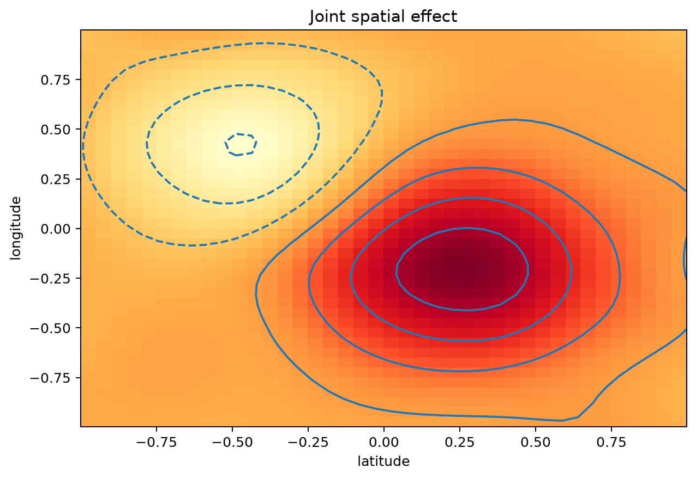

Estimate an Interaction Surface
===============================

Can separate latitude and longitude effects describe a localized spatial
pattern? Usually not: the effect of one coordinate changes with the other. A
tensor-product smooth represents their joint contribution.

In this controlled synthetic example, ``latitude`` and ``longitude`` are
centered local coordinates measured in degrees, and ``response`` is a unitless
environmental index. ``spatial_data`` contains 700 sampled locations and the
index observed at each one.

.. code-block:: python

   from nampy.gam import GAM

   model = GAM(
       formula=(
           "response ~ te(latitude, longitude, "
           "bs=c('cr', 'cr'), k=c(8, 8))"
       ),
       family="gaussian",
       optimize_smoothing=True,
       smoothing_method="reml",
   ).fit(spatial_data)

   figures = model.plot(pages=1, scheme=2, rug=False)

The color and contours show one joint term, not two marginal curves. Its
reported contribution depends on both named variables. Centering preserves
prediction reconstruction, but does not make main and interaction effects
unique when overlapping terms are included.
