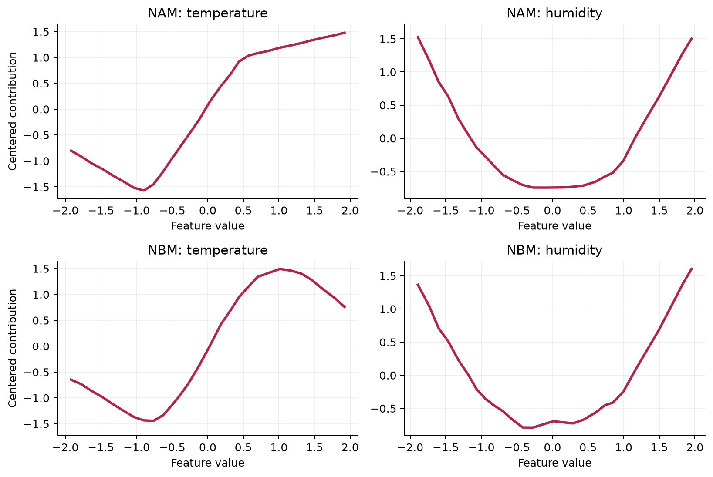

Compare NAM and NBM Feature Functions
=====================================

How much does the learned representation change the effects when the data and
training protocol stay fixed? This example fits a NAM with independent
feature networks and an NBM with shared learned bases.

The controlled data use standardized temperature and humidity values; zero is
the study mean and one unit is one standard deviation. ``response_index`` is a
unitless synthetic outcome with a sinusoidal temperature effect and a
quadratic humidity effect.

.. code-block:: python

   import numpy as np
   import pandas as pd

   rng = np.random.default_rng(17)
   temperature = rng.uniform(-2.0, 2.0, 700)
   humidity = rng.uniform(-2.0, 2.0, 700)
   X = pd.DataFrame({"temperature": temperature, "humidity": humidity})
   response_index = (
       1.7 * np.sin(1.5 * temperature)
       + 0.65 * humidity**2
       + rng.normal(0.0, 0.18, 700)
   )

.. code-block:: python

   from nampy.models import NAMRegressor, NBMRegressor

   nam = NAMRegressor(
       layer_sizes=[24, 12], dropout=0.0,
       numerical_preprocessing="minmax",
   ).fit(X, response_index, max_epochs=30, lr=1e-2, random_state=17)

   nbm = NBMRegressor(
       layer_sizes=[16], num_bases=8, nary=[1],
       dropout=0.0, bases_dropout=0.0,
       numerical_preprocessing="minmax",
   ).fit(X, response_index, max_epochs=30, lr=1e-2, random_state=17)

   nam_effects = nam.explain_terms(X, center=True, max_bins=28)
   nbm_effects = nbm.explain_terms(X, center=True, max_bins=28)

Both estimators return centered link-scale contributions through the same
interface. NAM assigns a separate network to each feature. NBM learns reusable
basis functions and combines them for each term, so similar curves do not
imply identical parameterizations. See :doc:`../models/nbm` before
interpreting terms created after categorical expansion.
