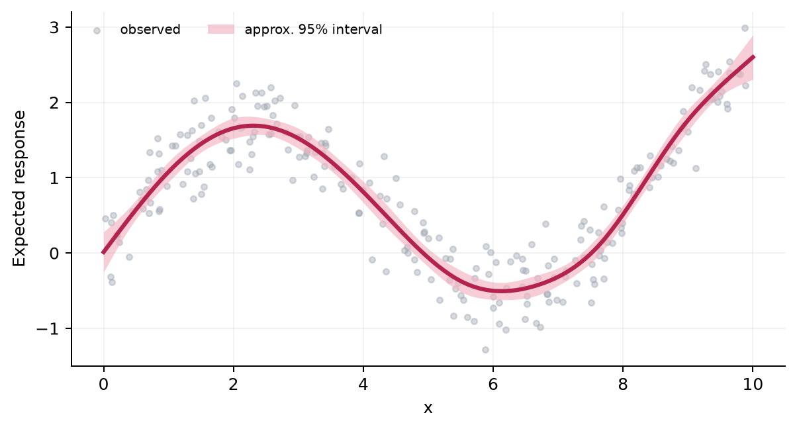
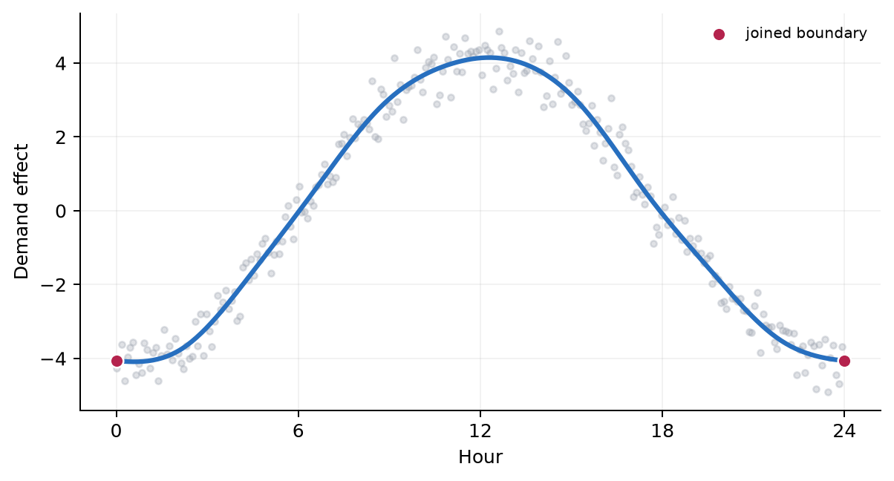
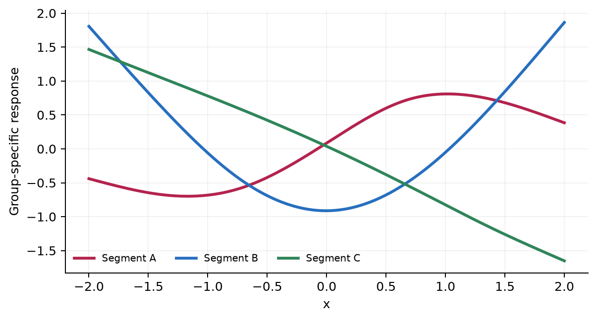
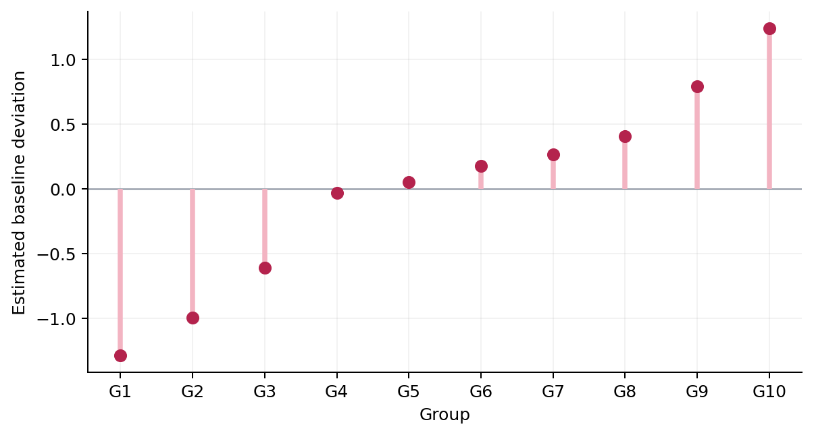
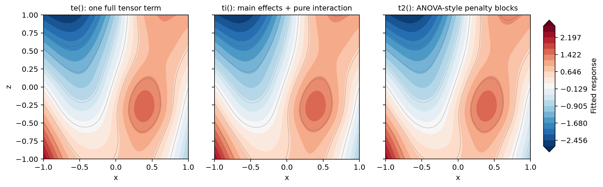
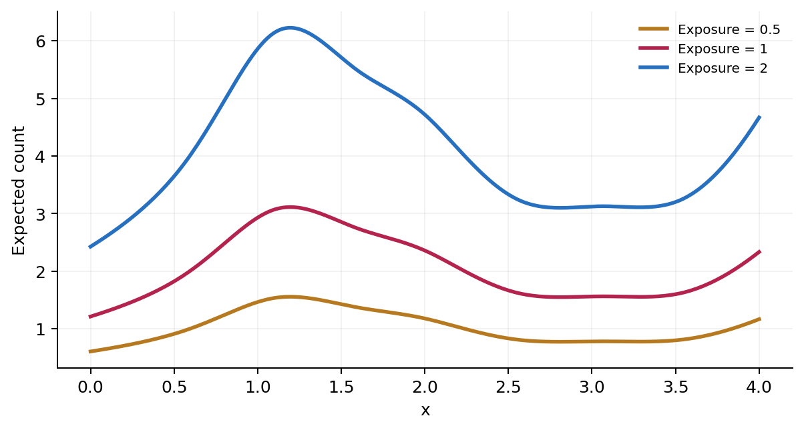

.. _formula-visual-reference:

Formula syntax: a visual reference
==================================

A formula term should express a modeling question, not just select a basis.
This page pairs the terms used most often with a fitted example and the
question each term answers. All plots below come from NAMpy ``GAM`` fits; the
full basis-code inventory lives in the :ref:`smooth basis reference
<gam-smooth-bases>`.

Smooth a continuous effect
--------------------------

**Question:** How does the expected response change with ``x`` when the shape
is nonlinear and not known in advance?

.. code-block:: python

   y ~ s(x, bs="cr", k=10)

``s()`` estimates one smooth contribution. Here ``cr`` selects a cubic
regression spline and ``k`` sets its maximum representational capacity;
smoothness selection or ``sp=`` controls how much of that capacity the fit
uses. Choose this term when one variable can bend but its effect does not
depend on another variable.

Model periodicity
-----------------

**Question:** Should the end of a measured cycle join its beginning, as hour
24 joins hour 0 or December joins January?

.. code-block:: python

   demand ~ s(hour, bs="cc", k=12)

The cyclic cubic basis makes the fitted value and derivatives agree at the
boundary. An ordinary ``s(hour)`` has no such requirement and can create an
artificial jump at the seam. Set meaningful cycle endpoints in the training
data or with ``knots=``.

Fit group-specific curves
-------------------------

**Question:** Does the shape of the ``x`` relationship change across levels
of a factor?

.. code-block:: python

   y ~ s(x, segment, bs="fs", k=7, xt="cr")

An ``fs`` factor smooth fits a curve for every observed level while penalizing
the collection of curves. This is more than a group intercept: both the level
and shape may change. Use ``sz`` instead when you want factor-specific
deviations constrained to sum to zero around lower-order effects; see the
:ref:`structured basis inventory <structured-smooth-bases>`.

Add random effects
------------------

**Question:** Do groups have different baselines, with noisy group estimates
shrunk toward the overall mean?

.. code-block:: python

   y ~ s(group, bs="re")

The random-effect basis creates one penalized coefficient per group. Larger
penalties imply stronger pooling toward zero. Add numeric variables inside the
same term for random slopes or other simple random-coefficient structures.

.. _tensor-constructor-comparison:

Model a joint surface
---------------------

**Question:** Does the effect of ``x`` depend on ``z``, especially when their
units and appropriate smoothness differ?

.. code-block:: python

   y ~ s(x) + s(z) + ti(x, z, bs=c("cr", "cr"), k=c(7, 7))

Tensor products combine marginal bases without requiring ``x`` and ``z`` to
share units. The three constructors differ in how the surface and its
penalties are decomposed:

.. list-table:: Choosing ``te()``, ``ti()``, or ``t2()``
   :header-rows: 1
   :widths: 14 34 52

   * - Term
     - Fitted formula in the figure
     - Use it when
   * - ``te()``
     - ``y ~ te(x, z)``
     - The main effects and interaction should be represented by one full
       tensor-product term. Its function space includes marginal directions.
   * - ``ti()``
     - ``y ~ s(x) + s(z) + ti(x, z)``
     - You want a functional-ANOVA decomposition: the separate ``s()`` terms
       own the main effects and ``ti()`` contains the remaining interaction.
   * - ``t2()``
     - ``y ~ t2(x, z)``
     - You want a full tensor surface whose penalties are split into
       SS-ANOVA-style marginal range/null-space blocks.

These are three REML-fitted representations of the same data, not three names
for an identical design matrix. With ``ti()``, omitting the
separate main effects changes the question because the interaction basis has
those marginal directions removed. With ``t2()``, the alternative penalty
blocks can lead to different shrinkage even when its fitted function space
overlaps that of ``te()``.

Account for exposure
--------------------

**Question:** How does an event *rate* vary when rows were observed for
different amounts of time, distance, area, or population?

.. code-block:: python

   count ~ s(x) + offset(log_exposure)

For a Poisson model with a log link, ``offset(log_exposure)`` fixes the
coefficient of log exposure at one. NAMpy therefore models a rate while
predicting counts: doubling exposure doubles the fitted count without asking
the model to estimate that scaling. Formula offsets are recomputed from the
corresponding column in new prediction data.

Deeper statistical analyses
---------------------------

* :doc:`Group-specific curves and partial pooling <../notebooks/group_smooths>`
* :doc:`Smoothness and term selection <../notebooks/smoothness_selection>`
* :doc:`Tensor interactions <../notebooks/tensor_interactions>`
* :doc:`Derivative and prediction contrasts <../notebooks/derivatives_contrasts>`

Next steps
----------

Use :doc:`statistical_gams` for fitting, prediction, and diagnostic controls;
use :doc:`../howto/interactions` for interaction workflow details; and use
:ref:`gam-smooth-bases` when you need every accepted ``bs=`` code.

.. include:: ../_includes/tutorial_interaction_surface.inc
