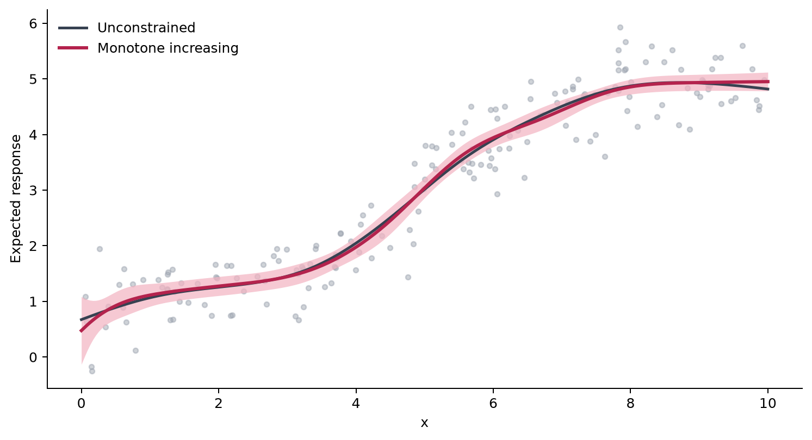
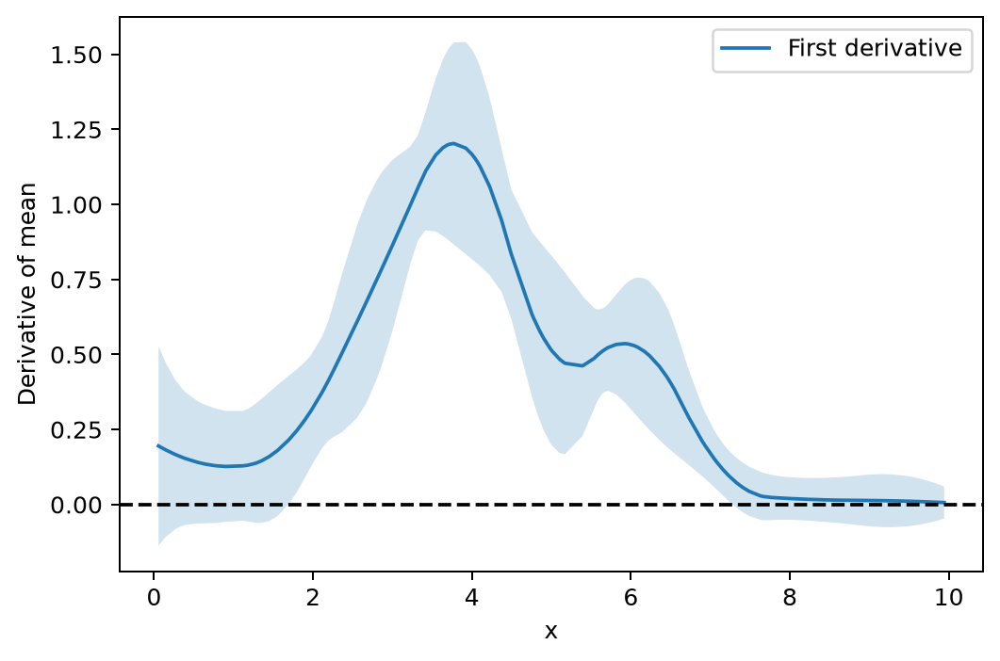

Shape-constrained GAMs
======================

Use a shape constraint when the direction or curvature of an effect follows
from the problem rather than from the observed sample alone. For example, a
dose effect may be expected to increase but not decrease over the studied
range. A constrained smooth encodes that assumption during fitting; it is not
a visual adjustment applied afterward.

.. _tutorial-monotone:

Compare an unconstrained and monotone fit
-----------------------------------------

Both fits use P-spline bases with dimension 12 and select smoothing by GCV using BFGS. The ordinary ``ps`` basis permits either direction; the SCAM-related ``mpi`` basis imposes monotone increase.

.. code-block:: python

   from nampy.gam import GAM

   ordinary = GAM(
       formula='y ~ s(x, bs="ps", k=12)',
       family="gaussian",
       optimize_smoothing=True,
       smoothing_method="gcv",
       smoothing_optimizer="bfgs",
   ).fit(data)

   increasing = GAM(
       formula='y ~ s(x, bs="mpi", k=12)',
       family="gaussian",
       optimize_smoothing=True,
       smoothing_method="gcv",
       smoothing_optimizer="bfgs",
   ).fit(data)

The unconstrained curve can turn downward locally when the observations are
noisy. The monotone fit cannot: its first derivative remains nonnegative over
the fitted range. This is useful only when monotonicity is scientifically or
operationally defensible. Otherwise the constraint can conceal real structure.

Inspect the fitted constraint
-----------------------------

The derivative is an estimand, not merely a visual property of the plotted
line. For the first smooth, request its first derivative and Bayesian standard
error:

.. code-block:: python

   derivative = increasing.derivative(smooth_number=1, deriv=1)
   derivative.derivative
   derivative.se

Check the derivative over the fitted range and report the scientific reason
for imposing the constraint. A nonnegative derivative confirms what the
chosen basis enforces; it is not an independent test that monotonicity is true.

Fit a constrained smooth
------------------------

Use a ``scam`` basis code in an ordinary ``s()`` term. Fixed smoothing and
compatible automatic GCV/UBRE selection are both available:

.. code-block:: python

   from nampy.gam import GAM

   fixed = GAM(
       formula="y ~ s(x, bs='mpi', k=10)",
       family="gaussian",
       smoothing_method="fixed",
       smoothing_params=[0.5],
   ).fit(data=df)

   selected = GAM(
       formula="count ~ s(x, bs='mpi', k=10)",
       family="poisson",
       optimize_smoothing=True,
       smoothing_method="ubre",
       smoothing_optimizer="bfgs",
   ).fit(data=df)

``positive_transform="exp"`` is the SCAM default.  Set
``positive_transform="softplus"`` to use SCAM's ``not.exp=TRUE`` map;
``softplus_beta`` and ``softplus_threshold`` expose its two numerical
parameters.

Univariate bases
----------------

Representative choices are ``mpi``/``mpd`` for increasing/decreasing effects,
``cx``/``cv`` for curvature, and ``po`` for positivity. Local constraints can
encode a justified change point. The exhaustive codes and their arguments
are listed in :doc:`../api/gam_smooths`.

Bivariate bases
---------------

A constrained surface can use, for example, ``s(x, z, bs='tedmi', k=c(6, 5))``
for a supported monotonicity construction. Check the direction and margin
semantics in :doc:`../api/gam_smooths` before choosing a basis.

Linear functionals
------------------

Matrix-valued covariates use a shared row-wise weighted basis-aggregation
contract. It is available for ordinary ``ps``, ``cr``, ``cs``, and ``cc``
smooths and for SCAM's ``*by`` bases.

For SCAM signal regression, store each row of evaluation locations and
weights as array-valued DataFrame cells, then use the location column as the
smooth covariate and the weight column as ``by``::

   model = GAM(
       formula="y ~ s(locations, by=weights, bs='mpdby', k=12)",
       family="gaussian",
       smoothing_method="fixed",
       smoothing_params=[0.5],
   ).fit(data=df)

Inference and diagnostics
-------------------------

Prediction uses the shape-valid coefficient space, while optimization state
remains available as ``fit_result().coef_optimization``.  The corresponding
Bayesian and frequentist covariance matrices are exposed in both spaces.
``predict(..., return_se=True)``, ``summary()``, and all ordinary residual
types use the transformed covariance, as ``scam`` does.

``derivative(smooth_number=1, deriv=1)`` returns first- or second-derivative
values and Bayesian standard errors for a univariate constrained smooth. The
smooth number is one-based.

Derivative evaluation is term-owned. Ordinary P-splines also support exact
first and second derivatives at training or new data. SCAM derivatives retain
the upstream training-data semantics; unsupported new-data derivative
requests fail explicitly.

Continuous quantile residuals are available with
``residuals(type="rquantile")`` in addition to ``deviance``, ``pearson``,
``scaled.pearson``, ``working``, and ``response``.

For correlated Gaussian errors, see :doc:`../notebooks/correlated_errors`.

Current boundaries
------------------

For transformed shape-constrained models, use fixed smoothing or a supported GCV/UBRE route. Automatic ML, REML, and LAML selection is not available for these models. The compatibility reference lists restrictions for multi-parameter models and other combinations.

See :doc:`../api/gam_advanced` for fitting compatibility and coefficient-space details.
